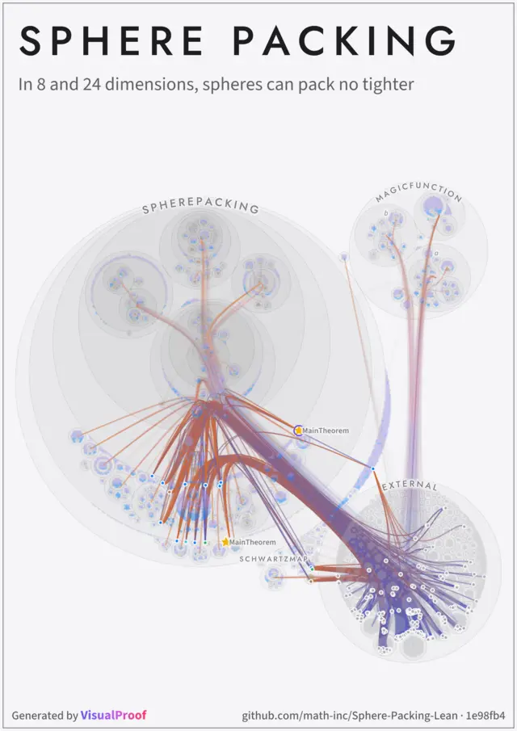
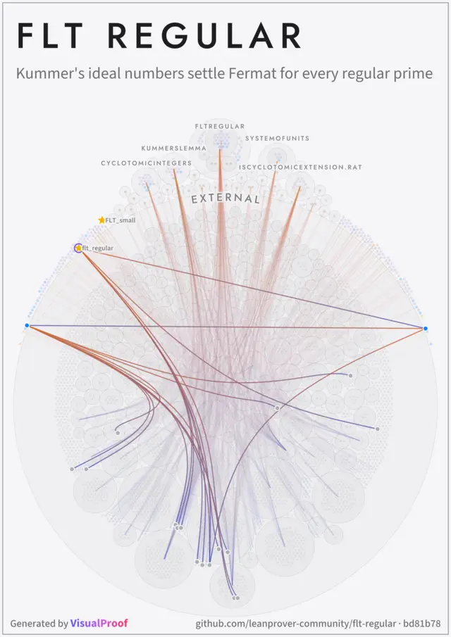
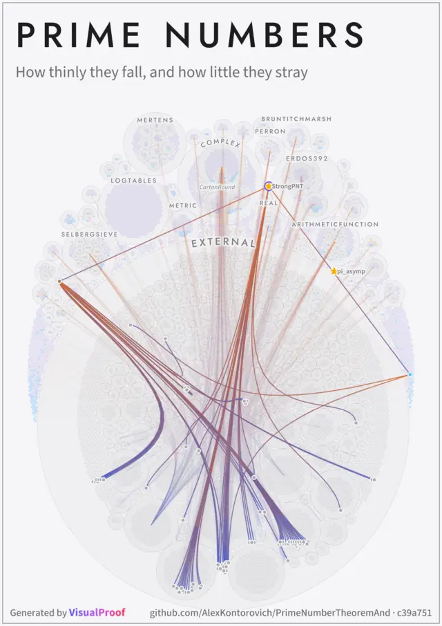
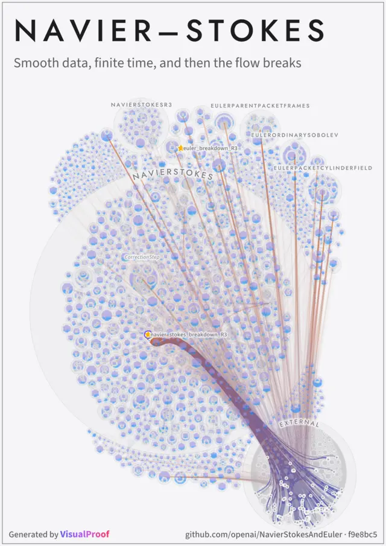
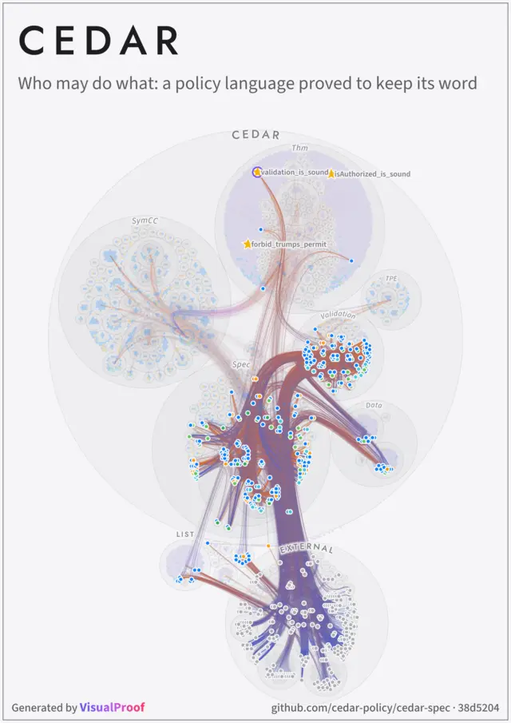
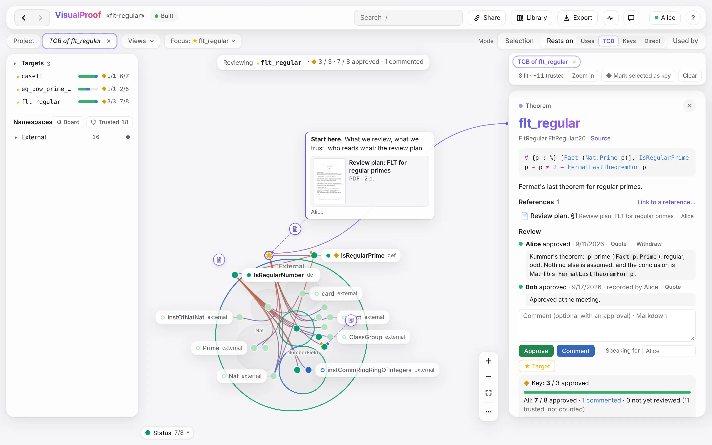

# VisualProof

<p align="center">
  <a href="https://github.com/math-inc/Sphere-Packing-Lean"></a>
  <a href="https://github.com/leanprover-community/flt-regular"></a>
  <a href="https://github.com/AlexKontorovich/PrimeNumberTheoremAnd"></a>
  <a href="https://github.com/openai/NavierStokesAndEuler"></a>
  <a href="https://github.com/cedar-policy/cedar-spec"></a>
</p>
<p align="center"><sub>Five Lean codebases, drawn by <code>visualproof artwork</code>.</sub></p>

https://github.com/user-attachments/assets/98e435d6-f493-437d-b342-1833819c0b77

<p align="center"><sub>A review of Sphere-Packing-Lean in 74 seconds. The whole tour — four minutes in thirteen chapters, with captions — is in the page under <b>?</b> → Tips, and <a href="https://visualproof-demo.yingte.io/#tips">on the live demo</a>.</sub></p>

[](https://visualproof-demo.yingte.io)

<p align="center"><b>Live demo: <a href="https://visualproof-demo.yingte.io">https://visualproof-demo.yingte.io</a></b><br><sub>flt-regular in the middle of a review by three people and an AI assistant, read-only</sub></p>

## Try it

Set up in your Lean codebase with agent prompt:
```text
Set up VisualProof (https://github.com/LucianoXu/VisualProof) for my Lean project, and give me the address to open.
```

Or have your codebase drawn as a poster:
```text
Draw my Lean project as a poster with VisualProof (https://github.com/LucianoXu/VisualProof): pick its main theorem, light up what its statement rests on, and give me the PNG and the SVG.
```
What the agent does, step by step: [A poster from the command line](docs/MANUAL.md#a-poster-from-the-command-line).

Set up manually:
```bash
npm install --global visualproof
cd my-lean-project && lake build
visualproof serve .
```

It needs Node, elan and Poppler ([Requirements](#requirements)). On the first visit the page offers
a short tour of your own project; `?` holds the tips — a film of a review on Sphere-Packing-Lean in
thirteen scenes, with captions, and a row for each thing it does not show — and every key.

## See what a Lean theorem actually rests on

Lean checks that a proof is correct. It cannot check that the theorem says what you mean: that the
definitions in its statement mean what their names suggest. VisualProof shows exactly which
definitions those are, so that people, and AI agents, can read them, review them together, and
keep a record of the review.

On [flt-regular](https://github.com/leanprover-community/flt-regular), Fermat's Last Theorem for
regular primes. Of the project's
273 declarations, two light up besides the theorem, `IsRegularPrime` and `IsRegularNumber`: they
are what you need to read to believe what it says. The Mathlib definitions they use light up too,
trusted and assumed as Mathlib is, unless a review chooses to read them: the walk stops at the
project's edge.

<p align="center">
  
  
  
</p>
<p align="center"><sub>The theorem alone · what its statement rests on, its TCB · the few the review marked key, read first.<br>This review no longer trusts <code>Mathlib.NumberTheory</code>, so the definitions it holds that the statement means, <code>FermatLastTheoremFor</code> among them, are read too, and can be key.</sub></p>

## What it does

- **The declaration graph** of a built Lean project, clustered by namespace or by file, and updated
  live as you rebuild.
- **The TCB of any theorem**: the project's definitions its statement rests on, followed through
  their bodies, instances and notation, and the axioms its statement and proof use. What lies only
  inside proofs is left out, since Lean has checked it; what lies outside the project, Mathlib's
  definitions, is lit but trusted and assumed.
- **A review together**: approve or comment on each declaration, mark targets and their key
  declarations, leave notes, link papers to declarations, and see what changed since an opinion was
  given. Everyone on the page sees it live.
- **AI agents as reviewers**, through a JSON API and an MCP server. They read, advise and annotate
  under their own names, and their opinions stay advice.
- **History**: every build is kept, and a past board can be browsed.
- **A printed document** of what a view holds: definitions in full, proofs left out, typeset with
  XeLaTeX.
- **A picture of the board**, PNG or SVG up to poster size: from the page, from an agent's link, or
  without a browser (`visualproof artwork <project> --recipe recipe.json`,
  [step by step](docs/MANUAL.md#a-poster-from-the-command-line)).

## Requirements

- Node 22.18 or later in 22, or 24.2 or later.
- [elan](https://github.com/leanprover/elan), which installs each project's Lean toolchain. Lean
  v4.28.0 to v4.35.0 are supported.
- Poppler (`pdfinfo`, `pdftotext`, `pdftoppm`).
- Optionally XeLaTeX, for the printed document.

The project must have been built with `lake build`: VisualProof only reads what the build left,
and never builds it.

## Where it keeps things

It writes nothing into the project, and nothing into its own checkout. It keeps everything in two
places:

- **The site folder** (`--site <dir>`) holds the review and what the running site accumulates: the
  history of builds, the library, views, notes, the timeline, agents' tokens. By default it is
  `~/.local/share/visualproof/sites/<project>-<hash>/` (on macOS, under
  `~/Library/Application Support/visualproof/`). It cannot be derived again and holds secrets, so
  back it up and keep it out of git.
- **The cache** (`--cache <dir>`) holds what a rebuild makes again, and the patch releases a server
  took (`versions/`, with `updates.json`, the last check: code the server runs, so the cache is the
  server's user's alone). By default it is `~/.cache/visualproof/` (on macOS,
  `~/Library/Caches/visualproof/`).

## Reviewing with others

By default the server listens on this machine only. To let others in:

```bash
visualproof serve flt-regular --host 0.0.0.0 --access-key-file ~/visualproof.key
```

Whoever you give the link `http://<host>:4173/k/<key>` gets in; the key is what the file holds,
and one is made if there is none. **Share** invites a person with a link of their own, shows the
project with a read-only link (nothing changes, nobody sees the reader), or gives an AI agent a
token and a prompt. To put a project online for anyone, read-only, add `--public`. The server
speaks plain HTTP: beyond a trusted network, put a TLS proxy in front. [SECURITY.md](SECURITY.md) says what the server trusts and what it exposes.

## Updating

A server keeps itself up to date with patch releases (`--updates auto`, the default): it asks npm
once a day and takes a newer release of the same minor version, 0.4.1 after 0.4.0, at a quiet
moment (nobody on a page and nothing running, a day later at the latest); the pages left open
reload where they were. A newer minor version, which may change the command line or the site
folder, is only announced — in the server's log, by `visualproof doctor` and in the About of the
page's `?` — with the command it prints to install it, e.g.
`npm install --global visualproof@0.5.0`; once it is installed, the server restarts into it by
itself within ten minutes. `--updates notify` announces patch releases too, and `--updates off`
never asks npm. 0.3.0 has no updater: upgrade it to 0.4.0 by hand
([the manual](docs/MANUAL.md#updates)).

## Documentation

- **In the page**: the tour, offered on the first visit, and the tips under `?`: a film of a review
  in thirteen scenes, each with a few words, and a row for the rest. They are the documentation to
  start with.
- [The manual](docs/MANUAL.md): how to start, the concepts, then every part of the page, the review,
  views, history, the printed document, collaboration, and how the TCB is computed.
- [The agents' API](docs/agent-api/README.md), which the server also serves to agents, topic by topic.
- [SPEC/](SPEC/): the specification, and the design decisions behind each part.
- [CONTRIBUTING.md](CONTRIBUTING.md), for working on VisualProof itself.

## License and citation

VisualProof is licensed under Apache-2.0 ([LICENSE](LICENSE)). The fonts in `src/assets/fonts/`
are JuliaMono; those in `src/assets/webfonts/`, which artworks are drawn in, are Source Sans 3,
Source Serif 4, Jost, Noto Sans and Noto Sans Math. All are under the SIL Open Font License, whose
text is beside them. If you use VisualProof in your work, please cite it
([CITATION.cff](CITATION.cff)).
