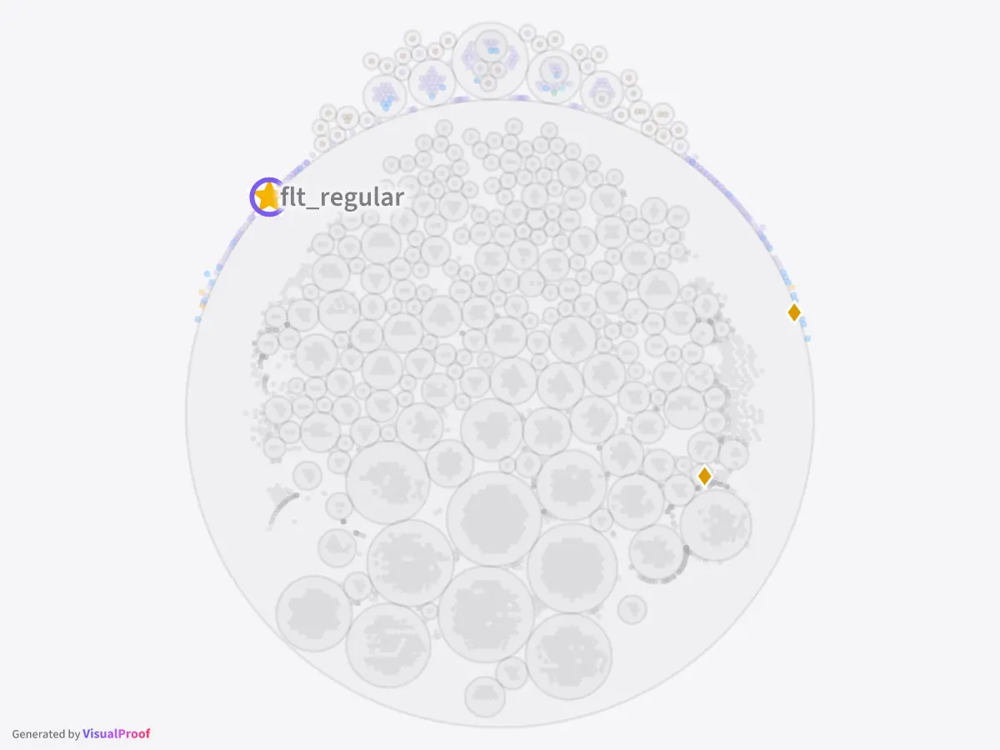
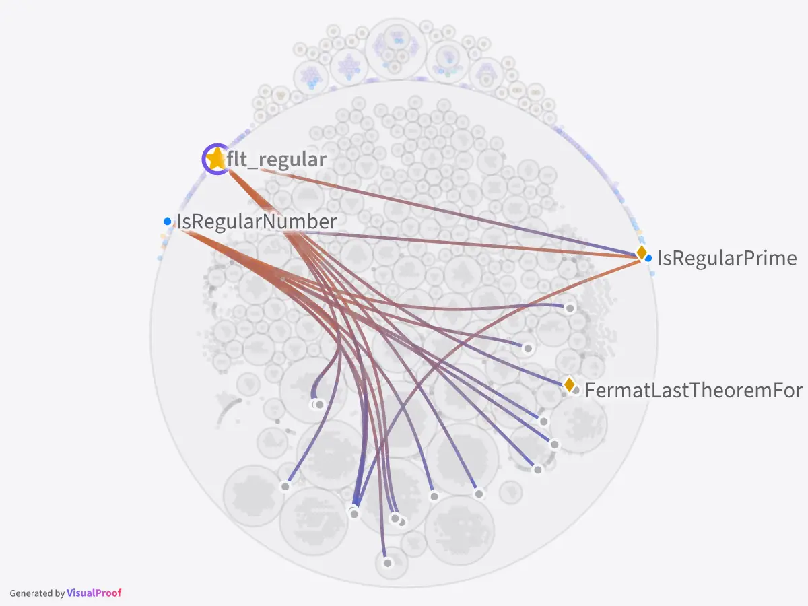
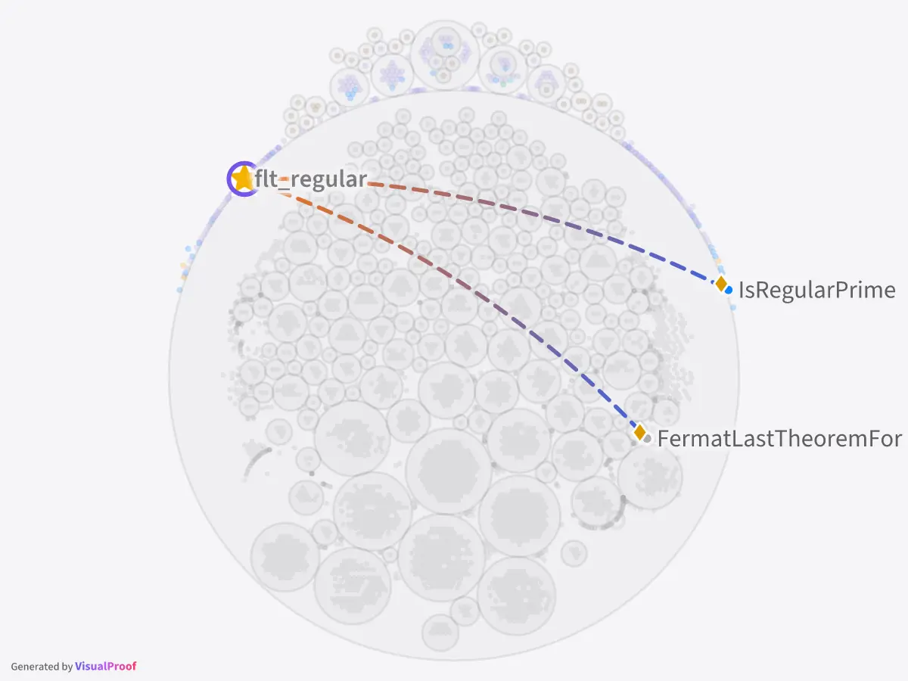

# VisualProof manual

The full reference to VisualProof: how to start, the concepts, then the page, the review, views,
history, the printed document, collaboration, agents, and how the TCB is computed. For a first look,
see the [README](../README.md); in the page, the tour and the tips under `?` show each part at work.

See a Lean codebase's declaration graph, and the trusted computing base (TCB) of any theorem in it:
the project's definitions its statement rests on, the notation it is written in and the axioms its
proof uses, what it reaches outside the project being assumed ([Concepts](#concepts)). The owner's specification
is [SPEC.md](../SPEC/SPEC.md); the decisions are in [CanvasSpec.md](../SPEC/CanvasSpec.md),
[ReviewSpec.md](../SPEC/ReviewSpec.md), [CollabSpec.md](../SPEC/CollabSpec.md), [AgentSpec.md](../SPEC/AgentSpec.md),
[ViewSpec.md](../SPEC/ViewSpec.md), [TCBSpec.md](../SPEC/TCBSpec.md), [ExportSpec.md](../SPEC/ExportSpec.md),
[HistorySpec.md](../SPEC/HistorySpec.md), [AttachmentSpec.md](../SPEC/AttachmentSpec.md),
[PhoneSpec.md](../SPEC/PhoneSpec.md) and [DeploySpec.md](../SPEC/DeploySpec.md).

## Start here

1. **Install**: `npm install --global visualproof`. It needs Node, elan and Poppler;
   `visualproof doctor <project>` checks this machine and the project, and says what to do.
2. **Build, then serve**: `lake build` in the project (VisualProof never builds it; on Mathlib,
   `lake exe cache get` first), then `visualproof serve <project>`, and open
   http://127.0.0.1:4173/. The first visit starts a short
   tour on the project itself; `?` holds the tips and every key. Or serve a branch of a git
   repository, `visualproof serve https://github.com/<owner>/<repo>`, which the server builds
   itself at each commit ([Following a branch](#following-a-branch)).
3. **Review a theorem**, in five minutes:
   1. Find it (`/` searches names, statements and docstrings), click it, and **☆ Mark as target**
      in its panel: from now on its review is counted, in the Targets list at the top of the side
      panel.
   2. In **Rests on · TCB**, the mode the page starts in (`2`), a click on it lights its TCB: what
      you read to believe it says what you mean. **Its view**, in its panel, opens a board of its
      TCB, the review focused on it.
   3. There, mark the few declarations that carry its meaning **key** (`k`, one selected). Then
      select the target again: the Keys step of Rests on (`2` again) lights them alone.
   4. Read each in the source window (Space), the key declarations first, and **Approve** (`a`) or
      **Comment** (`m`). The review strip counts what is approved.
   5. **Share** lets others in — a person, a read-only reader, an AI agent — and **Export** prints a
      view, or makes a picture of it.

The words used here are the next part's; the rest of the manual is the reference.

## Concepts

<p align="center">
  
  
  
</p>
<p align="center"><sub>flt_regular three ways: the theorem alone · its TCB · its key declarations
(<code>scripts/docs-figures.mjs</code>, on the flt-regular showcase). That review no longer trusts
<code>Mathlib.NumberTheory</code>, so the definitions it holds that the statement means,
<code>FermatLastTheoremFor</code> among them, are read too, and can be key.</sub></p>

- **The TCB of a theorem**, its trusted computing base: what you must read to believe it says what
  you mean. Lean checks that the proof is correct; it cannot check that the statement means what
  its names suggest. The TCB holds the theorem; the definitions, structures, inductive types and
  instances its statement rests on, through statements and definition bodies, and what those rest
  on in turn inside the project; the project's notation they are written in, with the code it
  runs; and the axioms its statement and its proof use, as `#print axioms` gives them (a `sorry`
  shows). Left out: what is used only inside proofs, wherever it occurs, Lean having checked it;
  the instances of classes whose instances are all equal (`Decidable`, `Fintype`, …); Lean's
  kernel and toolchain. **The walk stops at the project's edge**: a declaration of Mathlib or Lean
  core that it reaches is in the TCB as a leaf, lit on the board but trusted and assumed, as the
  libraries outside the project are (unless the review stops trusting it, below); what it rests on
  is not followed. The pictures above are one theorem selected three ways: **Selection**, the
  theorem alone, whose statement the panel shows; **Rests on · TCB**, its TCB; **Rests on ·
  Keys**, its key declarations ([What you see](#what-you-see) has every mode; [How the TCB is
  computed](#how-the-tcb-is-computed), the precise rules).
- **Trusted without review**: what a TCB reaches that nobody needs to read — by default Mathlib,
  Lean core (`Init`, `Lean`, `Std`) and Batteries, and the standard axioms (`propext`,
  `Classical.choice`, `Quot.sound`). A part of the project, or the whole outside world, can be
  trusted too, and a part of the outside world no longer trusted, its leaves then read as the
  project's definitions are ([Review](#review)). Trusted declarations stay in the TCB, light green
  on the board (a dim green in the dark theme), but need no opinion and are not counted — **nor in a TCB's size**: for flt_regular
  above, the selection bar says *8 lit · +11 trusted*, it and the 7 to read, then what is assumed,
  and the panel's Counts *7 in TCB*, *+11 trusted* beneath. The rest of the TCB, with every
  non-standard axiom the theorem reaches, is its **review set**, what its review counts. "Trusted"
  always means trusted without review: the panel lists the TCB itself as **Its TCB**.
- **A target**: a theorem whose TCB is reviewed, marked ☆ by a reviewer (or by an agent at level
  `full`). It carries a gold star, and the Targets list says how far each review has come.
- **Key declarations**: of a target's TCB, the few that matter for reading it — the central
  definitions, the structures they are built on, the main theorem — marked key for that target (a
  gold diamond); the target always is one. A trusted declaration can be key too, in the project or
  outside it: trusted says it needs no review, key that it is needed to read the target. They are
  read first, and progress counts them first: ◆ approved of the key declarations that need review
  (the trusted ones told apart, *+N trusted*), then approved of all. A declaration that is not key
  is *supported by* the key declarations that reach it through members that are not key; the **key
  graph** joins key declarations reached so, dashed.
- **The review's focus**: a view reviews one target at most, its focus, set when the view is made
  from the target. **Focus ▾**, at the top left, shows it: there each reader may focus otherwise for
  themselves alone (another target linked to the view or on its board, or none), remembered per
  view and taken by whoever follows them, or make their focus the view's, for everyone on it. With
  a focus there is the review strip, `k` marks key for that target, and Keys lights that target's
  key declarations; without one there is no strip and no `k`, and Keys lights every target's (a
  target clicked: its own).
- **Opinions and their versions**: an opinion, an approval or a comment, is on a declaration's
  version: its statement, and for data its body, the names it refers to followed through renames.
  When the declaration changes, the opinion shows as given on an earlier version, **stale**
  (orange), and **What changed** shows the lines since; a rename alone stales nothing. A
  declaration's status is what reviewers said of its present version: commented, approved, stale,
  or nobody yet. An AI agent's opinion is **advice**: shown apart, never counted.

## Run

```bash
visualproof doctor <path-to-lean-project>     # what is missing, if anything, and what to do
visualproof serve <path-to-lean-project>      # then open http://127.0.0.1:4173/
```

The README says how to install the `visualproof` command. A checkout also runs as it is, after
`npm install`: `node src/server/main.ts` in place of `visualproof`.

- Needs Node 22.18 or later in 22, or 24.2 or later, and the project's Lean toolchain through
  elan. `visualproof doctor <path>` checks this machine and the project, and says what to do.
- The project must have been built: VisualProof reads what `lake build` left in `.lake/` and
  never builds the project. A build in progress or a broken one is shown as such (see Live), with
  the last graph that could be read. It writes nothing into the project: what it keeps is in the
  site's folder and the cache (below). A git URL in its place follows a branch instead, which the
  server builds itself (Following a branch, below).
- Modules to read come from the default targets: `defaultTargets` in `lakefile.toml`, or the
  libraries marked `@[default_target]` in `lakefile.lean` (read as text, never run). A library
  stands for the modules Lake builds of it: its `globs` (`A`, `A.+` its submodules, `A.*` both),
  else its `roots`, else its name; a target that is no library is a module. `--root Name`
  (repeatable), a library or a module, wins: a project whose libraries cannot be imported together
  (a library of reference statements beside the proofs that restate them, as NavierStokesAndEuler's
  ComparatorChallenges) is read a part at a time.
- The first read of flt-regular (27 modules, on Mathlib) takes about 14 s, 11 of them compiling the
  extractor for its toolchain, which is done once per toolchain; Sphere-Packing-Lean (829 modules,
  7,851 declarations), about 55 s, its extractor compiled included; the showcase,
  NavierStokesAndEuler (read with `--root NavierStokes --root Euler`: 2,657 modules, 52,648
  declarations, 5.0 million edges), about 3 minutes.
  It is cached (`<cache>/extract/`) by a fingerprint of the `.olean` files, so a restart without a
  rebuild reads it at once (under a second). The usage pass follows (`--jobs`). Laying out a very
  large graph is not cached: every start of the showcase spends about 50 s on it, its graph served
  when that is done.
- `--port N` (default 4173).
- **Where it keeps things**: in two places — the site and the cache. Nothing else goes into the
  project, and nothing into this repository.
  - `--site <dir>` is the **site's folder**: the review's logs (`log/`) and what this running
    VisualProof site accumulates — the history of builds, the library's files, the views and their
    layouts (with the notes they keep), the timeline, the conversations, agents' tokens and
    personal links. By default `~/.local/share/visualproof/sites/<project>-<hash>/` (macOS:
    `~/Library/Application Support/visualproof/sites/…`); `--site` is relative to the current directory,
    as `--cache` is, or absolute; `<site>` below. It is local: it cannot be derived again and holds secrets, so back it
    up and never commit it. A folder the server makes gets a README saying so; one already there
    is left as it is. One server at a time uses a site (`<site>/.lock`): a second is refused, and
    says which process holds it.
  - `--cache <dir>` is the root of the **caches**, which a rebuild makes again: the project's in
    `projects/<project>-<hash>/` (extractions, the usage pass's results, prepared views, what was
    read of the library's files, typeset documents, Lean's language server's folder; `<cache>`
    below), the Lean programs compiled per toolchain and version of their source in `lean/`, shared
    by every project and checkout, the page's bundle in `web/`, and what the servers know of
    VisualProof's own releases: `updates.json` (the last check) and `versions/`, the patches they
    downloaded (see Updates), which is code the servers run, so the caches' root is kept the
    server's user's alone (`versions/` is made `0700`, and one others may write is refused); and
    `media/`, the tips' tour film, fetched on its first play (see Updates). By default
    `~/.cache/visualproof/` (macOS: `~/Library/Caches/visualproof/`). `XDG_DATA_HOME` and
    `XDG_CACHE_HOME` move both defaults, on any platform. The server says where the site and the
    project's caches are when it starts.
- `--jobs N` (default 8): how many modules the **usage pass** elaborates at once (0 turns it off).
  The pass finds which notation each declaration is written in and the exact context it is
  written in (see How the TCB is computed); it runs after the extraction, whose graph is served
  meanwhile, and its findings come as the next version of the graph, so open pages update. One
  process per module (a process cannot import twice); each takes hundreds of MB of its own besides
  the `.olean` files they all map, and import is bound by memory bandwidth, so past about a quarter
  of the cores more jobs gain less and less (a cold pass on Sphere-Packing-Lean, on 32 cores: 320 s
  at 4 jobs, 195 s at 8, 148 s at 16; the workers together hold 3 GB at 4 jobs, 4 GB at 8 and 6 GB
  at 16, the `.olean` files counted once; on the showcase's 2,657 modules, 26 min at 6 jobs). A cold pass on flt-regular (27 modules) takes about 14 s at
  4 jobs, its worker compiled first; results are cached per module (`<cache>/usage/`), so after a
  build only the modules whose `.olean` or imports changed run again (a build of flt-regular that
  touched 11 of them: 8 s; one of Sphere-Packing-Lean that changed a module 80 others import: those 81 in
  24 s, the merged graph served 51 s after the build), and a restart without a build serves the
  merged graph at once (under a second).
  On Mathlib a worker can hold several GB (the showcase's pass at 6 jobs peaked at 39 GB resident,
  15 GB of it the `.olean` files mapped once): `serve` and `doctor` say where the default `--jobs`
  may take more than the machine has available, and which `--jobs` fits. While less than a twentieth
  of the memory (2 GB at least) is available, the pass starts no worker until another ends, and says
  so in its log.
  Progress is in `GET /api/status` (`usage`) and the log; a module that cannot be elaborated is
  reported there and keeps the text-based context and no notation edges.
- `--graph <saved.json>` serves a saved extraction instead of reading the build.
- `--editor "<URL template>"` links each declaration to an editor: `{path}` is the file on the
  server, `{rel}` the file in the project, `{line}` and `{col}` where it starts (from 1). E.g.
  `vscode://file/{path}:{line}:{col}`, `vscode://vscode-remote/ssh-remote+HOST{path}:{line}`,
  `https://github.com/ORG/REPO/blob/main/{rel}#L{line}`. A reader can set their own in the `?`
  sheet (kept in that browser, per project). Snapshots carry none.
- `--identity-header <header>`: behind a proxy that signs people in (Tailscale, oauth2-proxy,
  Cloudflare Access), names come from that header instead of the page (see Together): UTF-8, or
  MIME encoded-words (`=?utf-8?q?…?=`, as Tailscale writes a name beyond ASCII). Only when the proxy
  is the only way in: the header is believed as it comes.
- `--host 0.0.0.0` serves beyond this machine (the default is `127.0.0.1`); `--access-key-file
  <file>` then lets in only those given the link `http://<host>:<port>/k/<key>` (the key is what the
  file holds; one is made there if there is none). The link leaves a cookie in the browser and goes
  on to the page; agents send `Authorization: Bearer <key>`, or a token of their own that Share made
  (`vpa_…`, which reaches `/api/agent` only); everything else is answered 404 — but a browser
  opening a page without the link, which is shown one saying the site is private and to open it
  with the link (a link that no longer opens it, a key replaced or a personal or read-only link
  revoked, says so and to ask for a new one), and nothing of the project. One key for everyone:
  taking someone out means a new key — or invite people one by one with a personal link from Share
  (`/i/vpp_…`, see Together), which lets in only its holder and is revoked on its own; to show the
  project without letting anyone change it, a read-only link (`/r/vpr_…`, see Together). Over plain
  HTTP the key crosses the network in the clear. The cookies' names are the server's own
  (`visualproof_access_<12 hex>`, `visualproof_person_<12 hex>`, `visualproof_readonly_<12 hex>`),
  so two servers on one host keep theirs apart.
- `--public`, with `--access-key-file`: whoever comes without the key or a link of their own is let
  in read-only (CollabSpec decision 11) instead of turned away — the way to put a showcase online.
  They see what a guest sees, change nothing that is shared, and are seen by nobody; agents are
  still let in only by the key or a token of their own. Without it, no address shows the project
  to someone not given a link, so no reader can make a private project public. Not with
  `--identity-header`, where the sign-in decides who comes in.
- `--public-url https://host` is the address people reach the server at, when it is not the one
  their browser sends (a proxy in front): every link Share makes (the guest link, read-only and
  personal links) and Copy link are made with it, and the prompt Share makes for an agent tells it
  this address; a link of it is this site's in a conversation (a chip) whichever address the page
  was opened at. Without it, the links and the prompt carry the address the person's browser used.
- `--allowed-host <name>` (repeatable): without `--access-key-file`, a server answers only requests
  for an IP address, `localhost` (and the names under it, `vp.localhost`), `--public-url`'s host
  and the names given here; any other name is answered 403 (a browser is shown a page that says
  so, and these options), so that a web page cannot reach it by making its own name resolve to
  this machine (DNS rebinding, [SECURITY.md](../SECURITY.md)). Give
  the names a proxy in front of it forwards, or this machine's own name if people use it
  (`--allowed-host lab-server.local`); the server's log says each name it refused once. With a key,
  every name is answered, the key keeping everyone else out.
- `--library-limit <GB>` (default 2): the most the project's library of papers and images may take,
  all its files together (see References). `visualproof purge-file <path> <sha256>` deletes a
  file's bytes from the library for good (a file added by mistake); nothing else does. Poppler
  (`pdfinfo`, `pdftotext`, `pdftoppm`) reads the PDFs on the server.
- `GET /api/status` says how the server is: the graph, Lean (running, crashed and restarted), the
  pages' event streams (at most 200 open, and read-only readers' 400 more, counted apart), and the review — its folder and any log line that
  cannot be read. Only the graph's own modules are ever served as source or opened in Lean.
- Pages far from the server wait on bytes, so the page's files and the graph are sent gzipped with
  a tag of their content: a browser that has them is answered 304 and loads in a second (14 KB
  instead of 727 KB for flt-regular, most of which is the page's own code). The edges go packed (shared/edgecodec.ts, a quarter of the
  bytes); JSON answers over 2 KB go gzipped. The review goes gzipped too, tagged with its revision:
  the event stream says only which revision the server holds and what changes, so a page reads the
  whole review as it loads, and again only where it missed a change (a reload of an unchanged
  review is answered 304). The build status of every file travels the same way (`GET /api/build`):
  while a build runs, the stream carries only the files whose status changed (on
  NavierStokesAndEuler's 2,657 files, a change is tens of KB where the whole is 362 KB, 42 KB
  gzipped). Brotli would be smaller still, but browsers take it only over HTTPS.
- `docs/deploy/visualproof.service.example` is an example systemd user unit that serves a project this
  way: copy it and fill in its placeholders (it says how).
- `visualproof export <path> -o page.html` writes one self-contained HTML file (page, data
  and sources, 2.5 MB for flt-regular) that opens from disk with no server. It is frozen
  (`--label` names it).
- `visualproof artwork <path> --recipe recipe.json` makes the picture an artwork recipe says (the
  agents' API's: [export](agent-api/export.md), "Artwork") without a browser: the same picture as
  the page's artwork mode, as an SVG and a PNG (`--png` or `--svg` for one). `-o` names the files (a
  name, or a path without its extension); else the recipe's title, else the project's name. With
  `--site`, the board is the Project view as that site keeps it — its layout, pins, folds and hidden
  levels — and the targets are its review's; without, the board as a new site would lay it out and
  the targets the recipe names. `--screen 1920x1200` (the default; 640x480 at least) is the screen
  the board is drawn on, as a reader's would be: the smaller the screen, the larger the names in the
  picture. A selection is a declaration's full name, or a name the graph folds into one (an equation
  lemma, a constructor: the one it is folded into); a name it has not is answered with the name
  likely meant. It says what it wrote — the names, those a rule left out where they would have
  covered another, the targets, the selection — then the files; a name, target or view the build has
  not, or anything else that fails, ends it with status 1. It reads the build and the site and writes
  only the files and, in the cache, the extraction and the usage pass's results (never the site, nor
  the laid-out views the cache keeps for a server); the same build, site and recipe make the same
  bytes. An A2 poster at 300 dpi of a project of 15,000 declarations takes about 20 seconds and
  1.2 GB of memory, most of it drawing the PNG; a picture of more than 80 million pixels is drawn in
  bands, in 2 GB at most but three times as long (16,384 pixels a side: 3½ minutes). Notes are not
  drawn yet. A poster step by step, the recipe's choices explained: [A poster from the command
  line](#a-poster-from-the-command-line).

### Following a branch

```bash
visualproof serve https://github.com/<owner>/<repo>               # its default branch
visualproof serve git@github.com:<owner>/<repo>.git --branch main --poll 5 --build-timeout 2 --mathlib-cache own
```

With a git URL where the project goes, the server follows that branch of the repository and builds
what it shows itself ([SPEC/DeploySpec.md](../SPEC/DeploySpec.md)): the board shows what is on the
branch, one build per commit, never someone's half-edited working tree — the way to serve a project
to a team. It needs git, besides elan.

- **The address**: `https://host/owner/repo`, `ssh://…`, git's `git@host:owner/repo.git`, or
  `file:///path/to/repo.git` for a repository on this machine. Never `http://` or `git://`, and
  never a user name, password or token in the address: the credentials are git's own (an SSH key, a
  deploy key, a credential helper), and VisualProof keeps none. Nothing ever waits on a prompt: a
  credential git cannot find, or an SSH host whose key is not in `known_hosts`, is a failure, said
  as such.
- **`--branch <name>`**: the branch followed, by default the remote's default branch (asked at each
  start, and remembered for a start without the network). Only that branch is ever fetched: never a
  pull request's or a fork's.
- **Its own clone**, in the cache: `<cache root>/deploy/<repo>-<hash>/clone/<repo>/`, one per URL
  and branch, made at the first start; never your workspace. (A deployment made by 0.5.0 keeps its
  clone where it was, `<repo>-<hash>/<repo>/`, and is not cloned again.) The site is the URL's and the branch's
  (`~/.local/share/visualproof/sites/<repo>-<hash>/`) unless `--site` says otherwise. One server
  follows a branch with a cache at a time. The other commands (`export`, `artwork`, `doctor`,
  `purge-file`) take the clone's folder, which the server names as it starts (`clone:`).
- **`--poll <minutes>`** (default 2): how often the remote is asked for the branch's head (`git
  ls-remote`). Each new head is built: fetched, checked out detached, `lake exe cache get` where the
  project is on Mathlib, then `lake build` (of what `--root` names, else the default targets) —
  **one build at a time**; heads pushed meanwhile are not queued: **only the newest is built after
  it**. A commit is built once, whatever came of it; one that could not be fetched is tried again at
  the next look.
- **`--build-timeout <hours>`** (default 6; from 0.05 to 168, fractions too: `1.5`): a `lake build`
  that takes longer is stopped and the build failed, its commit not tried again, so that a commit
  that never finishes does not hold back those pushed after it. The popover says why: `it took
  longer than 6 hours (--build-timeout): stopped`. A build done again after a restart has the whole
  time again.
- **`--mathlib-cache shared|own`**: where `lake exe cache get` keeps Mathlib's files. `shared`, the
  default: the user's, as their own builds (`~/.cache/mathlib`, or `MATHLIB_CACHE_DIR` in the
  server's environment), so that a deployment fetches only what they have not. `own`: the
  deployment's, in its folder of the cache, `<cache root>/deploy/<repo>-<hash>/mathlib-cache/`,
  apart from the user's builds. It holds one version of Mathlib, about 0.45 GB (8,684 files for
  Mathlib of August 2026: a small project's first build on it, Mathlib cloned and its cache
  fetched whole, took 75 s on a fast connection): after each `lake exe cache get`, `lake exe cache
  clean` deletes what the version checked out does not use, so that a bump of Mathlib, which
  fetches nearly all of it again, leaves the version before deleted (the user's cache is never
  cleaned). Removing `mathlib-cache/` frees it (the next build fetches what it needs again), the
  deployment's whole folder the clone with it. Either way, Mathlib's build unpacked in the clone's
  `.lake` takes about 8 GB.
- **Meanwhile the board keeps answering**, showing the last build: the pill says the build's step
  (`Fetching a1b2c3d`, `Mathlib's cache · a1b2c3d`, `Building 12 / 40 · …`), and once it is read,
  the new graph comes as any new build's does (see Live). The build-status popover (`b`) says, under
  its buttons, the branch and the remote, when it was last asked, the build going on and what it
  says now, the newest commit waiting, and the last build that ended: when, how long, and — where it
  failed — why, with the end of its log (to those let in fully: never a read-only reader), its
  paths written from the clone's folder (`.`) and the home (`~`), however links lead there. A failed
  build shows its failed files as any failed build does, in the Status colours and the popover, the
  board reading what could be; `Build failed · a1b2c3d` where no file says it (a lakefile that does
  not elaborate). The history keeps each build's commit, on the branch, so that the Time Machine's
  ruler has a long tick per commit; a failing commit whose build compiled nothing new is no new
  build, and is never said built: the popover says it failed and that the board shows the build
  before, which is what the history, the loading page and the agents call built. Each build's whole
  log is in `<cache root>/deploy/<repo>-<hash>/logs/<commit>.log`.
- **The first start** clones the branch (the terminal says it), then builds its head; until a build
  can be read, the page says what is being done (`The first build of github.com/A/B (main) at
  a1b2c3d: lake build, 3 of 8 files…`), and where it failed, why and what comes next, with the end
  of the log. It never stops waiting: the board appears as soon as a build can be read.
- **Restarts**: the clone and what is built stay in the cache. A build going on holds the updater's
  restart into a patch (see Updates) until it ends; one cut short anyway (or by a stop) is done
  again by the next server, Lake keeping what it had finished. A server whose last build is whole
  shows it at once.
- **Open on GitHub**: where the remote is github.com, the source window links each declaration to
  its lines in the build's commit (`blob/<commit>/<file>#L12-L17`), where the text shown is that
  commit's; the popover links the branch and each commit. A declaration from outside the project is
  linked in its package's repository at the revision the lake-manifest pins, whether a branch is
  followed or not (Review, Source).
- **Safety** ([SECURITY.md](../SECURITY.md)): **whoever can push to that branch runs code on this
  machine** — the lakefile, and what elaboration runs — as the server's user. Run it as a user of
  its own, give that user a deploy key that only reads the repository, and protect the branch.
  There is no sandbox yet. `docs/deploy/visualproof-branch.service.example` is a systemd unit for it.
- Times, on a machine with a fast connection: [quote4](https://github.com/leanprover-community/quote4)
  (14 modules, no dependency) cloned in 1 s, its first build 25 s (elan fetching its toolchain), its
  board 35 s after the start; [flt-regular](https://github.com/leanprover-community/flt-regular)
  (27 modules on Mathlib) cloned in 1 s, Mathlib's cache (9,055 files) and its build 1 min 12 s, its
  board with notation 1 min 50 s after the start; a restart, its board in a second.

### Updates

A server follows VisualProof's own releases (SPEC/UpdateSpec.md). It asks the npm registry, through
the npm of the Node it runs on (so npm's registry, proxy and certificates hold), at start and once a
day; `--updates` (or `VISUALPROOF_UPDATES`) says what it does with what it finds:

- **auto** (the default): a **patch** of the version it runs (0.4.1 for 0.4.0) is downloaded into
  the caches' root (`~/.cache/visualproof/versions/0.4.1/`, the root `--cache` names, not a
  project's cache), checked to run on this Node, and taken at a quiet moment — nobody on a page
  (read-only readers too) and nothing running (an extraction, the usage pass, a document being
  typeset), within a day. Open pages reload where they were, each within a few seconds: the view,
  the selection, the camera, the source windows and what was being typed come back; a page that is
  in the middle of something (typing, a drag, a note being written, the export window, the artwork
  mode, the linear form) waits, its build pill saying "Updated — reload". While the server
  restarts, the pill says "Updating to 0.4.1…".
- A **newer minor** (0.5.0) is never taken by itself: it may change the command line or the site.
  The log, `visualproof doctor` and the help's About part say it is out, with the command that
  installs it where this one was installed (`npm install --global visualproof@0.5.0`) and its
  release notes. Once it is installed, the server restarts into it by itself, within ten minutes.
- A release its publisher deprecated (`npm deprecate`) is neither taken nor told of, and a server
  running it from the cache steps back at a quiet moment (to the newest ready patch that is not,
  else the installed package): that is how a broken patch is withdrawn. Each check asks of the
  version it runs and the patches the cache holds too; what one server found is kept for the
  others in `updates.json`, until npm answers otherwise.
- **notify**: told of, never downloaded. **off**: the registry is never asked (a machine kept
  offline), and the server runs as one process. `VISUALPROOF_UPDATES=off` keeps `visualproof
  doctor` from asking it too.

The tips' tour film is not in the package (it is 30–60 MB): the first time a page plays it, the
server fetches it from the project's GitHub release, checks it against the sha256 the package pins,
keeps it in the caches' root (`media/`, where an earlier film no living server pins is removed) and
serves it from there — readers' browsers never reach GitHub; meanwhile the page waits, and where it cannot be had the tour shows its stills and
captions. `--updates off` means the server reaches the network for nothing of its own: neither the
registry nor the film. `VISUALPROOF_TOUR_FILM=<file>` serves a local film in its place.

`visualproof serve` from an installed package is a small supervisor that runs the server as its
child and starts it again in the new version. A patch that fails before it serves is set aside for
every server of the user, one that fails twice soon after it served for that site alone (for all
once two sites saw it), with why (`~/.cache/visualproof/versions/bad.json`; the log, the doctor and
the help say it), and the version before it runs again; a SIGKILL never counts, nor running out of
memory once it served. Where the version before it fails as soon, the fault was not the patch's: it
is taken back, and that site's patches are paused: its server runs the installed package for a
day, or until a newer patch is out (so it does after six starts in ten minutes; out-of-memory kills
are started again after a growing wait, and do not count). The pause is
`~/.cache/visualproof/versions/paused.json`, one entry per site; the log, the doctor and the help
say it. To lift it sooner, remove the site's entry (or the file) and restart the server. One set
aside is tried again a day on, and kept aside for good after its third failure; the records are
`versions/bad.json`, which may be removed as well. Under `--updates notify` the installed package runs, whatever the
cache holds. The servers of one user share `versions/`: none removes a version another runs. Where the Node a server runs on is gone (upgraded by Homebrew), it keeps running and
says why. `visualproof --version` says the installed package; the server's first lines, `GET
/api/updates` and the help say the version it runs. Activity records each version that serves the
site ("Updated from 0.4.0 to 0.4.1"), and each build's snapshot the version that read it. A checkout
never asks the registry. 0.3.0 has no updater: upgrade it by hand (`npm install --global
visualproof`, then restart the server).

## Supported Lean versions

Lean v4.28.0 to v4.35.0. The extractor and the usage pass are compiled with each project's own
toolchain, and Lean's internals change between releases, so every supported toolchain is tested:
[test/toolchains.json](../test/toolchains.json) lists them. The policy is the last six or so stable
releases, and whatever the showcase project needs (v4.34.0-rc2, for NavierStokesAndEuler); v4.28.0,
for the sphere packing formalization (the showcase before it), stays the floor.

- `npm run test:toolchains` runs the tests whose answers can depend on the toolchain — those that
  build the fixture with it — once per toolchain: the oldest and the newest, at once; `-- --all`
  every one (`-- --jobs N` runs N at once, two by default; `-- v4.30.0` only that one). CI runs
  every one before a change is merged. `VP_TOOLCHAIN=v4.30.0 npm test` runs the whole suite with
  one. elan installs a toolchain the first time it is asked for it.
- `test/compat.test.ts` compares the extraction of the whole fixture with a golden taken on the
  fixture's own toolchain ([test/golden/](../test/golden/)): what is the project's — its units, the
  edges between them, their axioms and TCBs — must be the same on every toolchain; what Lean's
  library and its generated code put in may differ only as `known-differences.json` lists, each with
  the toolchains it holds for and why. `npm run golden:update` takes the golden again.
- Before v4.29 a failed file shows as out of date (see Live).

## Live

While `serve` runs, it follows the builds you run yourself (and, following a branch, those it runs
itself: Following a branch):

- **Build status, every second.** The pill beside the project name says `Built`,
  `Building 12 / 40 · <file>`, `2 failed · 5 blocked`, `3 out of date` or `Built · 4 with sorry`
  (`Offline` when the server cannot be reached), followed by ` · reading…` while a new graph is
  read, ` · partial graph` while some modules are missing from it, or ` · reading notation…` while
  the usage pass runs; click it (or press `b`) for the list of files and why, and click a file to
  fly to it. At rest this costs next to nothing: the server watches the folders of the project's
  files and the compiles running, and looks at the files when something moves (and every 30 s
  besides). On a network or FUSE filesystem, which does not tell of changes made elsewhere, it looks
  at them every second instead, as its log says (`watch: …`).
- **A new graph when a build settles**, swapped into the open page: same camera, same folds, same
  selection. Nodes that existed keep their place; new ones are fitted in beside their cluster.
  `Re-layout` (⚙ Board, over the side panel's tree) starts the board afresh: its pins are dropped, other boards keep theirs.
- **Broken builds stay readable.** When a file fails, the graph is read from everything that can
  still be imported and says which files are missing; until then the last good graph stays up.
- **A snapshot of every build** ([HistorySpec.md](../SPEC/HistorySpec.md)): each build the server reads is
  kept in `<site>/history/` — when it finished, its commit (read-only `git`), and every module's
  extracted content, a module that did not change stored once (`GET /api/history`,
  `/api/history/graph?id=`, `/api/history/diff?from=&to=`). The first start with a history imports
  the extractions the cache already holds, one snapshot per build. On flt-regular a whole build
  takes about 0.2 MB gzipped; a later build only what its changed modules hold (32 KB after an edit
  of one file).
- **The source text of every build** (HistorySpec decisions 20–23): each file's text kept as git
  keeps blobs, `<site>/history/sources/<sha256>.gz`, written once whatever number of builds
  compiled it, and each snapshot says which text each module's build was compiled from. A text is
  kept only where its Lake hash is the one the build's trace records — the file as it is when the
  build is read, else the file in the commit checked out then — and otherwise is *not kept*: a text
  that is not the build's is never shown as the build's. The snapshots kept before are backfilled
  once, at start, in the background: by that hash where the cache still says it, else by
  the places the snapshot recorded (imports, where each declaration starts and ends, its doc and
  name), among the build's commit, the commits made on top of it, the working tree and the texts
  kept already (read-only `git`); the log says how complete each snapshot came out. On flt-regular
  every text of a build is 62 KB gzipped, and a later build adds a few KB (`GET
  /api/history/source?id=&module=`).

| State | Meaning | On the canvas, in the Status colours |
|---|---|---|
| failed | its last build failed (Lake deleted the `.olean`), or it was never built | its declarations dark grey (near white in the dark theme), the file's outline too |
| blocked | something it imports failed; shown as last built | as last built (by review) |
| out of date | its source changed since it was built, or something under it did | as last built (by review) |
| building | being compiled now | its declarations sky blue, the file's outline too |
| queued | waiting in a running build | as last built (by review) |
| with sorry | built, and a declaration uses `sorry` | what reaches the sorry reddish purple, the file's outline too |

By kind nothing on the canvas tells of the build: the pill does, and the Status colours.

"Out of date" uses Lake's own content hash of the source, so touching a file without changing it
is not a change. What Lake leaves behind, and how it was established, is in
[docs/LAKE.md](LAKE.md).
Before Lean v4.29 Lake keeps a failed file's previous `.olean`, so nothing on disk tells a failure
from an edit not yet built: there a failed file, and what imports it, show as out of date, and the
graph is read from the last build.

## What you see

Every declaration is a point. **The selection** is a list of picks, each one thing clicked with one
tool, and what is lit is exactly their union — computed on the whole project, then what this board
holds; it shows at the top right as one chip per pick (×
takes one off), with how much is lit — what is not trusted, then the trusted apart (*8 lit · +11
trusted*), whatever the tool — **Zoom in** and **Clear**. A lit declaration gets a card
beside it with a short lead to its point, so that the point stays in sight; a card never covers
another card, a lit point, a pick's ring or the panels, one with no room stays a point, and a card
keeps its side as the view moves. A pick has no card: a ring marks it, and a lead runs from the
thing last clicked to the panel on the right, which tells of it — nothing said twice, nothing
covered. The canvas is drawn with WebGL; text stays real text on top of it.

**The mode is the tool** (top right, *Mode*): how the next click selects. What each mode does
shows while the pointer is on its button, and nowhere else. With something selected, choosing
another tool selects the pick last clicked again under it, alone: from Selection only the last
pick stays; back to Selection, only the one thing clicked. **Rests on** is one mode at three
granularities (ViewSpec decision 20), its steps beside it while it is the mode: `2` enters it at
the step last used (TCB at first) and, pressed again, steps TCB → Keys → Uses → Direct.

| Tool | A click on a declaration (or a cluster: all its declarations) selects | Key |
|---|---|---|
| Selection | just it; **shift-click** adds it or takes it off, one pick at a time | 1 |
| Rests on · Uses | it and everything it uses, proofs included | 2 |
| Rests on · TCB | it and the definitions its statement rests on, proofs skipped | 2 |
| Rests on · Keys | it and the key declarations in its TCB: where the review has a focus that target's, elsewhere every target's (a target clicked: its own); the key graph's edges join them, dashed | 2 |
| Rests on · Direct | it and what it uses directly, in its statement, its body or its proof | 2 |
| Used by | it and everything that uses it | 3 |

A cluster picked covers the picks inside it. With any tool but Selection, a click makes the
selection that one pick. A click on empty space, or `Esc`, clears it.

- **Clusters** (namespaces or files) are circles, and circle inclusion is the cluster tree: a
  circle holds exactly its cluster's sub-clusters and declarations, also while things move.
- **The pointer highlights one thing**: the most specific target under it that is visible at this
  zoom — a declaration once declarations are far enough apart, a card, a folded cluster, or the
  innermost cluster whose circle is large enough. A click selects it, as the tool says — a
  cluster too, which has a panel of its own (what it holds, its review, its trust, what is inside
  it); a **double-click** folds or unfolds a cluster. **A drag pans** the view, anywhere, or with
  the middle button; the wheel zooms. A drag starts after 6 px, so a click never moves anything.
- **The right click** opens a menu on what is under the pointer (`Shift F10`, or the ContextMenu
  key, on what is selected): on a declaration, its source (or in a pinned window), its TCB, what it
  uses or what uses it selected, its full name copied, *Copy link*, *Remove from this view* or *Add to view ▸*,
  marking it key (where the review has a focus) or a target, approving or commenting, trusting its namespace;
  on a cluster, fold, *Copy link*, remove, add to a view, trust; on the empty canvas, *Copy link to
  what I see*, fit and Re-layout; on a note, *Copy link* among its items; and
  everywhere *Add a note here* and *Add a note for this view*. What you cannot do there is not
  offered. **Copy link** (ViewSpec decision 21) copies a link to it on this board, and *Copy link to
  what I see* a link to everything you see (as Share's *Exactly what I see* makes one, whatever its
  switch); the page says what the link leads to. These links carry no key: whoever opens one must be
  let in already — a conversation shows it as what it leads to (Together, below), and Share makes the
  links that let people in. Read-only readers have it too. The Project holds a fixed scope: there, *New view without it…* makes a copy of the board
  that leaves it out, and opens it.
- **Notes** (CanvasSpec, "Notes"; AttachmentSpec decisions 13–19): a note is the project's, and
  everyone sees it at once. It belongs to views as declarations do: the Project shows every note;
  another view shows the notes in its clusters, the notes that carry a file linked to what it
  holds, and the notes added to it — written or dropped there, or added with the note's *Add to
  view ▸* — less those taken out with *Remove from this view*. Write one with *Add a
  note here* (`Ctrl Enter` saves, `⌘ Enter` on a Mac): plain text with **bold**, *italics*, `code`,
  and full names in backticks as links. It is a small round icon at its place — a note, an image, a
  paper, or a note with a clip, by what it carries — and, expanded, its card hangs from the icon on a
  thin line, up and to the right unless the screen has no room there. It sits in the cluster where it
  was put, at the same spot of the circle on every board whatever its size, and moves with it; a view
  that does not hold that cluster shows it only where it was added or a link brings it, on the ring,
  toward what it is linked to. Each clustering has its own place for it: under the other one it is on a ring around the
  board, on the side of what it is about (hover it to light those declarations), its card hanging
  outward, until you drag it into a cluster there; let go where no cluster is, it goes on the ring at
  that angle. A build that
  renames its folder or namespace carries it along. *Add a note for this view* writes a note of that
  view alone, drawn with a dashed ring and edge; a note's menu makes it *Only in this
  view* or *In every view*, keeping its text and author. A folded cluster hides its notes and shows
  how many. A click on the icon expands or collapses a note, for everyone; zoomed out, only the
  icons show. A long text scrolls in its card — the wheel, two fingers, a finger or its scrollbar —
  and the wheel zooms only off it. Double-click a card to edit it, right-click the icon or the card
  to edit, collapse, switch or delete it; drag the icon to move the note — the cluster it would go
  in, or the ring, lit meanwhile — and drag the card to hang it elsewhere (with the lock let go, or
  the drag key held).
  Writing, editing and deleting a note are in Activity. **Fit to screen** (`f`) frames the notes'
  icons with the board, and their cards where they fit.
- **What a note carries** (AttachmentSpec decision 12): files of the library and clips of their
  pages, at most 8 a note — an image, a whole PDF shown by its first page and title, or a clip, a box
  of a PDF's page — drawn on its card under its text; a click opens one
  in the reference window, a clip at its page with its box lit. **Every file of the library is on
  the canvas**: added through the library, by anyone, it comes with a note on the Project's ring,
  collapsed, titled by the file; link it to a declaration and it shows on every view that holds that
  declaration too. **Drop a file on the canvas**, or **paste an image**, and it goes into the
  library and makes a note carrying it where you let it go, titled by the file and open for your
  words; several files make one note each. In the reference window, press **▭** and drag a box,
  then **Clip to a note**: a note beside the declaration selected on the board, its text the label you type. A note's menu has **Attach…** (a file of the library,
  whole or a clip of a PDF) and **Detach**.
- **The lock** (behind ⋯ at the bottom right, or `l`) is on by default: a drag pans and nothing
  moves; a click still selects and a double-click still folds. Let it go ("Drag moves nodes"; ⋯
  carries a dot) and a drag moves the declaration or the cluster it starts on, for everyone on the
  board. Hold the drag key — **⌘** on a Mac, where Ctrl+click is the right click, **Ctrl**
  elsewhere — for the other way while it is held: on a locked layout, move a declaration; on an
  unlocked one, pan over it. Your choice is kept in this browser, for every project.
- **Folding** gathers a cluster into one body and lets its neighbours move in where there is
  room; it never makes the parent larger. `−`/`+` (Depth, in ⚙ Board) fold and open whole levels;
  level 0 leaves only the top clusters.
- **Positions are hierarchical**: a cluster's are relative to its parent. Move a cluster (a drag
  with the drag key, or with the lock let go) and everything in it comes along; move a declaration and it
  stays where it is dropped. A drag stays
  inside the parent's circle (top-level clusters go anywhere); to move something further, drag
  what holds it. Neighbours make way and spring back; what a moved declaration depends on leans
  after it. Pins and folds belong to the board: everyone on the view sees them (see Views).
- **Edges** are bundled along the cluster tree. With nothing selected, statement and body edges
  between what is visible are aggregated (zoomed out, between clusters) and drawn faint; an edge
  only a proof or grammar holds is not drawn there. The selection's edges are drawn on top, the rest fade to a faint trace that still shows (in an artwork too); under Keys, the key graph's edges among what
  is lit instead, dashed.
- **Names** float over everything else on the board, each on a halo of the background that fades
  outward, so that no edge or point crosses a name. A cluster's name sits inside the top of its
  circle; declarations' names show once you zoom in, those nearest the middle first, none over
  another.
- **Going somewhere**: a row in the panel's lists, a name in a signature or the source, a search
  hit, a target — is a click there with the tool: the panel tells of it and the lead points to it; ‹ and › in the bar and in the source
  window (or the browser's own back and forward) step through where you have been. The address always names what is shown, so
  it can be sent as a link.
- **Zoom in** (the selection's bar): a view, in a tab of its own, of exactly what is lit — the
  selection among what this board holds — laid out on its own by the same rules (see Views).
  Inside it everything works as anywhere. It is greyed out where it would change nothing: nothing
  lit, or this board holds just what is lit already. A cluster's panel has a Zoom in of its own.
  A large view takes a moment to lay out (seconds, for tens of thousands of declarations): the board
  you are on stays and answers meanwhile, the tabs say *laying out* where the new tab will be, and
  going back, or to another tab, gives the new view up.
- **Colours**: by kind, or by **status** — one colour per declaration for where it stands, the
  most urgent winning: being compiled, build failed, contains `sorry`, commented, stale, approved,
  not yet reviewed, trusted (CanvasSpec, "Colour schemes") — or by **Mine**, your own review: the
  same colours from your own opinions alone (what you approved, commented on, approved or commented
  before it changed, have not reviewed; what is trusted), nobody else's. While you follow someone,
  Mine is theirs, the legend naming them; without a name you have none, and the legend says so. A
  view where the review has a focus opens in Status, every other view in Kind; switching (`c` steps
  Kind, Status, Mine; or the legend) is the reader's own, kept per kind of view (and seen by
  whoever follows you). In Status and Mine each cluster's outline shows its review's progress, an
  arc for what is approved and one for what is commented. The **legend** at the bottom left folds to a chip naming the scheme; open,
  it counts the board's declarations per colour. No rings tell of status on the canvas. **An axiom
  is a ring**, in either scheme: its dot has a ring of its own colour around it, a gap apart, on the
  board, in an artwork, in the legend, the panel and the search, so that it is told by its shape
  where its colour is not (to a red-green colour-blind reader the Kind palette's axiom red and
  structure green are one colour).
- `/` searches names, statements and docstrings (every word must be found; name matches first,
  then statements, then docstrings, each with the matching words highlighted in a snippet). A
  name Lean generated from a command finds the declaration it is folded into ("also declares").
- `1`–`3` the tools (`2` again: the next step of Rests on), `/` search, `Space` the selection's
  source (its window opened or closed), `Esc` close what is open, then clear the selection, `f`
  fit, `+` / `−` zoom (also the buttons at the bottom right), `[` / `]` fold or open one level
  (also the Depth buttons), `e` the outside world on this board
  (for everyone on it; the Project always holds it), `g` edges, `l` the lock, `c` colours by kind, status or your own review, `b` build status,
  `p` a frame meter, `a` / `m` approve, comment (see Review), `k` mark as key for the focus, `t` the Time Machine (`←` / `→` a build before or after,
  `Home` / `End` the first or the last), `Shift F10` (or the ContextMenu key) the menu on the
  selection, `?` the help menu.
- **A first visit** is offered the tour, never given it ([GuideSpec.md](../SPEC/GuideSpec.md)): once
  the page has been still for a moment, a small card — *New here?* — offers **Take the tour** (about
  a minute), **Watch a review** (the film below, from its start) and **Not now**. Start working
  instead and it folds into a dot on `?`; it shows once per browser and project, and not at all
  when you arrive by a link to a place, follow someone, or open a snapshot (the dot alone). The
  tour is ten steps on a real theorem. One step shows what the theorem rests on in three views: the
  theorem alone, its statement in the panel; its TCB; its key declarations. The TCB and Keys views
  say how many each lights, as the selection bar counts them: the theorem and what is to be read,
  then what is trusted and assumed, never added in (*Its TCB lights 8: it, and 7 declarations to
  read — definitions, axioms, the project's notation. The 11 trusted, as Mathlib is, light too,
  and are assumed.*); what the proofs alone use besides; what is key. A read-only reader is told
  what they can do there. The tour leaves the page as it found it — your tool, your selection, the camera,
  and no step in the history; its last step points on to **Tips**.
- **`?`** (⋯ → Help on a phone; the `?` key) opens a menu: **Tips**, **Keys** (Gestures on a
  phone), **Take the tour**, then what the project's graph holds, when and under which toolchain it
  was read, and which VisualProof the server runs (and a newer release, to those let in fully) —
  a press there opens VisualProof's repository: its documentation, its code and its issues.
- **Tips** is a film of a review in thirteen scenes — marking a target, a view of what it uses,
  arranging the board, its source, its key declarations, three ways to check it, commenting and
  approving, the Project, Share, an agent, papers and notes, a typeset document, an artwork —
  beside its chapters, one row each (under it on a phone), with a bar of one segment per chapter
  under the player and captions over it (**CC** turns them off). The film plays from the first
  chapter, muted, and the chapter playing opens its card: its words, **Show me**, which does it on
  your page (the control ringed, the tour's theorem selected where it helps; nothing anyone else
  sees), and **More**, its part of this manual; a click on a card, or Enter, plays from its start.
  **⤢** makes the film as large as the sheet, then the whole screen; Esc steps back; with the film
  focused, Space plays or pauses, ← and → go from chapter to chapter, `c` turns the captions on or
  off. The film is in the light theme (in a thin frame in the dark one). The server fetches it from
  VisualProof's releases the first time it is played and keeps it; until it has it (or offline),
  each chapter shows a still and its captions, as it does with reduced motion until you play it.
  An address ending in `#tips` opens the help on the film, `#tips=checks` at that chapter (the
  chapters' names: target, view, arrange, source, keys, checks, review, project, share, agent,
  library, export, artwork). Under the film, **More tips**: what it does not show, one row each — a
  click opens one — and a field to find one by its words. **Keys** lists every key and gesture and the "Open in editor"
  template. The ⓘ beside the panel's **Its TCB** opens the film at its chapter on the ways to check.
- **Tips in place**: now and then, when you are about to need it, a small card beside a control
  says what it does — the first time you select a theorem's TCB, the Time Machine opened, Export
  opened, … — and, where the film shows it, **Watch** plays its chapter. At most one in a page's
  visit, none in the visit of the tour, none while you follow someone. **Got it** ends it for good,
  and so does doing what it says; the Tips tab turns them off. What you have seen, and the
  release you last saw, are kept in this browser for every project: when the server runs a newer one, the page says **What's new** once, and the tips new
  in it are marked.
- **Light or dark**: behind ⋯ under the zoom buttons — light (the default), dark, or as the system is.
- **Reduced motion** (the system's setting) is followed on the whole page: nothing glides, fades or
  pulses — the camera, the linear form, the windows and menus are where they go at once.
- An edge runs from orange, at the declaration that uses, to blue, at the one it uses.

### On a phone

A screen at most 640 px wide gets a page for reading, reviewing and following; the board is
arranged on a larger screen ([PhoneSpec.md](../SPEC/PhoneSpec.md)). On it:

- **Fingers**: drag to move around, pinch to zoom, tap to select, double-tap empty board to zoom in
  there; touch and hold opens the menu on what is under the finger. Nothing on the board is moved by
  a finger, so the lock is gone.
- **⋯ at the top** holds the modes (each with what a tap selects), Share, the library, Export,
  Activity, the conversations, your name and help; what is new in Activity and in Everyone shows on
  ⋯ as one count, with an @ where you were mentioned. **☰** opens the targets and the board's
  namespaces or folders as a drawer.
- **The panel** is a sheet from the bottom: a tap on its handle gives it the whole screen or half of
  it, ✕ closes it. A declaration's source, Activity and the lost-and-found take the whole screen.
- No window is pinned, and the help (`?` in ⋯) holds the tips and lists the gestures instead of
  the keys. The tour is the phone's own, in the words of fingers.

### On an upright tablet

A tablet held upright, or a window narrower than 1000 px and at least 1.2 times as high as it is
wide, gets a larger screen's page, with everything on it, placed for the shape
([PhoneSpec.md](../SPEC/PhoneSpec.md), "Tall screens"). The page changes as the screen turns,
keeping what you were doing.

- **☰**, at the left of the view bar, opens the targets and the board's namespaces or folders as a
  drawer, as on a phone; the board has the whole width.
- **The panel** is a sheet from the bottom, across the screen, at half its height: drag its handle
  to make it taller or shorter, or tap it for the tallest and back. Activity, the lost-and-found and
  Export's window open in the same place.
- **Source windows, the reference window and the conversation window** dock there too, over the panel: side
  by side on a wide enough screen, one over the other otherwise; the handle above them sets their
  height. They are not dragged: the dock places them.
- The review strip and the selection bar go across the top, under the view bar; the legend and the
  zoom's buttons sit just above the sheet.

### On an upright monitor

A monitor turned on its side — at least 1000 px wide and 1.2 times as high, used with a mouse —
gets a desktop's page with its height put to use ([PhoneSpec.md](../SPEC/PhoneSpec.md), "Upright
monitors"): the board above, with the side panel at its left, and under it a **work area** across
the screen while something is in it.

- **The panel** is a pane at the work area's left; alone, it takes the whole width. Activity and the
  lost-and-found open in its place.
- **Source windows, the reference window and the conversation window** form one column at the panel's
  right, stacked from the top in that order — the reference the tallest, so that a page of a PDF
  reads well. One window alone takes the column's height; with no declaration selected the column
  takes the work area's width. They are not dragged: the column places them, and a collapsed one
  is a pill at its foot.
- **Splitters**: drag the one above the work area to share the height with the board, the one
  between the panel and the column, and those between the windows; a double-click gives each its
  own size again. Your browser keeps what you set.
- Everything else is as on a larger screen: popovers, menus, keys, the selection bar under the
  modes, Tips, Export's window, the Time Machine and the tour.

## Views

A view is a board ([ViewSpec.md](../SPEC/ViewSpec.md)): what is on it and how it is arranged are shared by
everyone on it; where you look, what you selected and your mode are yours alone; the
review is the same on every board. The page says so by where things are: the side panel on the
left is the board, the buttons at the bottom right are your eyes (zoom and fit; behind ⋯ the
lock, edges, the linear form, theme), the top holds your tabs and your mode.

- **The side panel**: the **targets**, each with its progress, opening its view on the target (one
  with no view is given a temporary view of its TCB, linked to it while it lasts); then the cluster tree, whose rows select their cluster. Over the tree, **⚙ Board** opens
  the board's settings beside the panel — its **Filter** (folded at first), clustering, depth and
  Re-layout — and **Trusted** (with how many prefixes) what is trusted. The targets and the filter
  fold away (a click on their heading; kept in this browser).
- **The panel** always shows what a declaration is and where, its statement, its doc and its
  review; why it is in the TCB, its counts, its axioms and the TCB's list are parts that fold
  (▸), kept as you leave them.
- **One page for everyone** (ViewSpec decisions 17–19): every tool, mode and key is there for
  every reader; what is used less waits behind ⚙ Board, Trusted, the panel's folding parts, ⋯ and
  the folding legend.
- **The scope** says what is on a board, as chips under Filter (⚙ Board): *everything*, *TCB
  of X*, *what X uses*, *what uses X*, *key declarations of T* (`key(T)`), a namespace or a folder, with conditions (*except what is
  trusted*, *without the outside world*, *only not yet reviewed*, *only not reviewed by me*
  (`mine(none)`: each reader sees what they themselves have not reviewed; also `mine(approved)`,
  `mine(commented)`, `mine(stale)`), *only what an agent comments on*, …). `+` adds one, `×` takes one off, a click on the first chip writes the scope as a query
  (`tcb(A.t) except trusted except external`). A change is everyone's on that board. The Project's
  scope stays *everything*: Duplicate it for a board that holds less.
- **Hidden levels** (ViewSpec decision 24): a cluster's row in the side panel (the struck-through
  eye under the pointer) or its panel has **Hide this level**: its sub-clusters and declarations
  move up into its parent, for everyone on the board, and nothing on the board moves; the top level
  can go too. ⚙ Board says how many levels are hidden, lists them and shows each again (or all).
  The exported document's sections follow what the board shows.
- **The arrangement** — clustering, folds, pins, depth — is the board's too, and goes to everyone
  on it at once; when someone changes the board you are on, a short note says so where it
  happened ("Alice folded 3 clusters"). **Re-layout** drops this board's pins only.
- **Tabs** are the views you have open, each remembering your camera, tool and selection. The
  **Views** menu makes a new view ("New view", "New view 2", …) or a copy of this one at once,
  renames or deletes it (it asks), and lists the views in one list: the Project, the kept views
  (the targets' first, each with a small yellow ★ naming its targets under the pointer), then those
  open that nobody keeps, in italics.
- **A view's title** (ViewSpec decision 25, the owner's decision of 2026-10-10) is its name where
  someone named it, never changed; else its scope in a few words, as the selection's chips say a
  pick — "TCB of ns CaseI", "keys flt_regular rests on", "what caseI uses", "TCB of Hilbert91 −
  trusted", "… @ Oct 9 22:27" for a view kept at a past build — a name said by its last part and
  as many parents as tell it apart from the project's others, about 30 characters and never more
  than 48. The same title is on the tab, in the Views menu, Activity, presence, the exported
  document and the agents' answers; under the pointer, the scope in full and its query. Save as
  new view names its view "Project @ Oct 9 22:27".
- **The Project** (everything) is always there. Marking a target makes no view: a click on a target
  with no view opens a temporary view of its TCB, "★ TCB of T", linked to it as long as that view
  lasts, and kept with it; a target is linked to at most one view, which can be another (Link to
  this view), and a view may be several targets', focused on the first. A view linked to a target is
  a view with a ★, called as any view is. It is deleted as any kept view, its targets then having
  none (ViewSpec decision 29). A view opened
  from a query — Zoom in, a link — is kept only once someone pins, folds or names it; until then
  it goes when the last person on it closes it, and its address opens the same query afresh.
- **The address** names the view (or its query), the tool, the selection as its query (`sel=`) and
  what the panel shows: a link — Share's too — opens the same board with the same selection, and
  following someone takes theirs; back and forward go across views. Each tab remembers its tool
  and selection.
- The Activity lists views made, renamed, rescoped (since 2026-10-09: who did it makes them one of
  the view's exported document's authors), deleted and laid out afresh.

## Review

What reviewers think of the declarations a theorem rests on ([ReviewSpec.md](../SPEC/ReviewSpec.md)).

- **One review box**, in the panel and in every source window, following or pinned, each on its own
  declaration: the same controls in the same order — the opinions and their history, the agents'
  advice, the comment box, **Approve**, **Comment**, **Speaking for**, **Withdraw** beside your
  opinion, the key mark, **☆ Mark as target**, and for a target its progress, its axioms outside the
  graph and its view.
- **Fold all** / **Show all**, at the head of the opinions (*Opinions 3 · 2 earlier*), folds every
  opinion to a line — who, approved or commented, when, *stale* — or shows them all in full, the
  earlier and withdrawn ones under *Earlier*; the agents' advice folds with them. It is your own
  reading preference, the same in the panel and every source window, kept in this browser. *What
  changed* under a stale opinion opens on its own, folded or not.
- **Approve** or **Comment** on the declaration (a comment needs text; an
  approval may carry one too); a new opinion replaces your earlier one, and the box empties once
  it is recorded. The first time, a window asks for the name your opinions are recorded
  under; it stays at the top right of the page (see Together). Each
  opinion is bound to the declaration's version (statement, and body for data, over everything its
  command generated, the names it refers to followed through renames, so that renaming something
  stales nothing): when the declaration changes, the opinion shows as given *on an earlier
  version*, and **What changed** shows the lines removed and added since (the opinion
  records the text it was given on: the context it is written in, then its source), so a
  re-review reads only the change.
- **Nobody approves twice**: Approve says where your approval stands — **Approve**, **Approved ✓**
  once you approved this version (under the pointer it reads *Withdraw approval*, and a click takes
  it back), **Approve again** once the declaration changed since. Approving what you approved
  already records nothing (an agent's advice neither), and `a` only ever approves: on what you
  approved, it does nothing. Speaking for someone, it says theirs.
- **Withdraw** takes your current opinion back: it stands beside it in every review box. An
  approval goes at once; a comment asks first. Afterwards you have no opinion there — every
  status, count and list is as if you had given none, and an earlier opinion of yours does not
  come back — but nothing is erased: the opinions shown keep it under *Earlier*, faded, and the
  withdrawal at its time ("Alice withdrew their approval"), and Activity says it. Speaking for
  someone, it withdraws theirs, recorded by you. A new opinion of yours stands as any. Agents
  withdraw their own advice ([docs/agent-api](agent-api/advice.md)).
- **Speaking for someone else**, when several of you review at one screen: type their name in
  **Speaking for**, beside Approve and Comment (the list offers the people invited and those who
  have recorded something). Until you clear it, every review box says *Recording for* them and its
  buttons say *Approve for* them: what you record is their opinion — it replaces theirs, counts as
  theirs, and shows under their name, *recorded by* you, without their ✓. Their own next opinion
  replaces it. Only approvals and comments, and withdrawing them; nobody records for an agent, nor
  does an agent.
- **Comments** read as light Markdown: `> quotes`, `` `code` ``, ```` ```lean ```` blocks (highlighted as in
  the source window), `**bold**`, `*italics*`; a declaration's full name in backticks links to it.
  Nothing else becomes HTML, and the logs and the agents' API keep the text as written.
  **Quote** on an opinion puts a quote of its comment into your box (trimmed to a few lines),
  its attribution linking back: once posted, a click there goes to that opinion and flashes it.
  In the source window, select some code and press **❝ Quote in comment**: the lines it touches,
  whole, go into that window's box under their file and line numbers, and once posted that
  header opens the source at those lines ([ReviewSpec.md](../SPEC/ReviewSpec.md), "Comments").
- **☆ Mark as target** a theorem whose TCB you review, from any review box. Its box then counts
  how far that review has come (approved, commented, stale, not yet reviewed; what is trusted is
  not counted: [Concepts](#concepts)), and **Its view** opens its board, or a temporary view of its
  TCB where it has none. The targets are listed
  at the top of the side panel, with their progress. What changes in a target's TCB shows by
  itself: an opinion on a declaration that changed goes stale, what newly enters it is not yet
  reviewed, and Activity records each change.
- **Reviewing a target** (on any view focused on it — its view, from the targets list or the panel):
  what is counted is its TCB without what is trusted (untrusted outside declarations stay) and the
  non-standard axioms it reaches, whatever the board holds. Its view opens under your tool, the
  target selected alone, and you read by following the names in the source window from one
  declaration to the next; a row of the review list, or the strip's target, selects one declaration
  under the Selection tool, and Rests on or Used by then show that declaration's part of the board.
  The strip is one line of progress, *Reviewing ★target · ◆ approved / K · approved / total*, with
  what is commented and stale, how many declarations agents comment on, and *All reviewed ✓* once
  your part is done; it has no button, and there is no *Next to review*. The target's panel lists
  the TCB in review order — bottom-up, what several targets share first — or by kind; over it,
  **Yours: Not reviewed · Stale · Commented** keeps the list to your own review (what you have no
  opinion on, where yours is on an earlier version, what you commented on), each with how many,
  kept in this browser. For each
  declaration the panel says **why it is in the TCB**: the shortest chain of references from the
  target. Keys: `a` approve, `m` comment (it asks for the text first).
- **Key declarations** ([ExportSpec.md](../SPEC/ExportSpec.md), decisions 1–4): a target's review set can
  run to hundreds of declarations; the few that matter for reading it are marked **key** for it
  ([Concepts](#concepts)). Where the review is
  focused on T, every review box — the panel's, and each source window's, following or pinned, on
  its own declaration — has **◇ Mark as key for T** (**◆ Key for T** once marked; `k`), and the
  selection bar **Mark selected as key** for the declarations clicked; whatever T's TCB holds can be
  marked, trusted or not, in the project or outside it, and the target is always key. A trusted key
  declaration needs no review: it is listed and printed with the others, marked *trusted*, and
  never counts as *not yet reviewed*; a key declaration trusted later stays key. Key declarations
  carry a small gold diamond on the canvas (where the review has a focus its target's, elsewhere
  every target's), a ◆ in the review list, which can show them alone (**◆ Key**, the trusted ones
  first), and `key(T)` in the query language, `key(targets)` for every target (the target's review
  box has **Key view**); the Keys step of Rests on selects them. They are read first: the review
  list shows them alone, and agents list them first. Progress has two levels, in the strip, the
  target's review box and the Targets list: *◆ approved of the key declarations that need review*
  (*+N trusted* beside it), then *approved of all*. A target's key document is its Key view
  exported (see Exported documents), a trusted key declaration printed as any.
- **Trusted without review** ([Concepts](#concepts)): Mathlib, Lean core (`Init`, `Lean`, `Std`), Batteries and the standard axioms by default. Trust a part of
  the project too (a vendored library, a layer reviewed elsewhere) with the shield on its row in
  the side panel's cluster list; Trusted, over that list, shows what is trusted and stops
  trusting it (defaults included, which can be put back). **The whole outside world** can be
  trusted at once, from that list or the shield on the External row (recorded as `@external`).
  Trusted declarations are not counted and need no opinion; the timeline says who trusted what.
- **Source** in the panel, or Space, opens the declaration's source in a window over the canvas,
  with its review box below it, the panel's (One review box, above). It is not modal: the canvas
  and the panels stay in use, and the window follows the selection, so a click on another
  declaration shows its source at once.
  It opens in the middle of the screen, as large as the code needs (at most 92% × 88% of the
  screen), and is fitted again to each declaration it shows until you move or resize it; then it
  keeps your place and size until you close it, and the next one opens in the middle again
  (nothing of it is kept in your browser). Long lines wrap to its width, their continuations
  indented under the line, so you only ever scroll down. Beside the code and the context above it,
  muted, are the file's own line numbers — of that build's text on a past build, of its package's
  file outside the project — one per line however it wraps, with a short dashed rule across them
  where lines are left out (between the context's commands, and before the code where it does not
  follow them). They are not part of the text: copying, quoting lines into a comment and Lean's
  hovers see the source alone. Drag its title bar to move it, an edge
  or a corner to resize it, and its – button or a double-click on the title bar collapses it to a
  pill with the declaration's name. Its **pin** keeps it on its declaration, a step aside: the
  next source you open (Space, Source) opens in a new window in the middle, so up to six pinned
  windows can be compared side by side; Approve and Comment in a pinned window, and `a`, `m`, `k`
  with the focus in it, are about its declaration, whatever is selected. Pinned windows are this
  page's (a reload starts without them; the reload into a new version, Updates below, keeps them). The window pressed last
  comes to the front; the conversation window stays in front of them all. Space closes the following
  window; Esc closes the window the focus is in, and from the page closes the following one. Above
  the code, muted, is the context it is written in, as Lean: the namespaces and
  sections around it, the `open`s, `variable`s, universes, options and local notation in force
  (`… in` ones included), folded to its first lines when long; the `variable`s whose names occur
  in the statement or the code are marked (a hint: Lean decides which it includes). Below the code
  of a declaration whose command made others ("Also declares" in the panel: what a declaring macro
  wrote beside it, the lemmas of `@[simps]`), "What Lean generated from this command" lists them, each with
  Lean's `#print` on a click. Every declaration named in the code is a link, dot notation included (Lean is asked
  what each name means). Hovering the code shows what Lean says is there, as in VS Code — types
  of names, binders, terms, with their docs — in a card you can move onto: rest on a name in it
  for that declaration's card, click to go there. The page runs Lean's language server on the
  file (read-only: it is started away from the lakefile, so it never builds). **Open in editor**
  (with `--editor`, or a template set in the `?` sheet) opens the declaration in your editor.
  When the file has changed since it was compiled, the window shows the present text,
  found by name, under a warning, and opinions wait until the file is compiled again: the graph,
  and an opinion's hash, are about the compiled version.
  **A declaration from outside the project** — Mathlib's, Batteries', any package's in
  `.lake/packages/`, Lean's core's (`Init`, `Std`, `Lean`) — opens the same way (the owner's
  decision, 2026-10-20): its file in its package, as Lake lays the package out, or in the
  toolchain's `src/lean/`, at the place its `.olean` records, with Lean's hovers and names linked;
  the title bar names the package and its revision (*mathlib at 089be84 ·
  Mathlib/Logic/Basic.lean:120–126*, *Lean v4.35.0 · Init/Prelude.lean:…*), and **Open on GitHub**
  opens those lines in the package's repository at that revision (Lean's core: `leanprover/lean4` at
  the toolchain's tag), where it is on GitHub. Where the package is at another revision than when
  the graph was read, the window shows its present text, found by name, under a warning. A
  read-only reader reads these too.
- On the canvas, the Status colours say what reviewers said about the present version (bluish
  green approved, a calm cobalt blue commented, orange stale, mid grey nobody yet, very light green
  trusted without review — in the dark theme a dim green, the quietest); the rows of a TCB list carry a dot of the same meaning. A target carries
  a gold star. While you type in a field, the shortcut keys are just text.
- **Renames** ([HistorySpec.md](../SPEC/HistorySpec.md)): at each build the declarations that vanished are
  paired with those that appeared. A rename of high confidence — the same version once names are
  mapped — carries what was said of it to its new name by itself: its opinions and comments, its
  target mark and the view linked to it, key marks, its pins, its mentions in notes and its name in views'
  scopes, as a move in `log/visualproof.server.jsonl` where something was said of it; its opinions
  stay fresh, since a pure rename changes no version. Renames of medium confidence are suggested. A
  migration is undone with `POST /api/history/unmove {id}`, and what was said of a declaration gone
  without a confident rename is attached to another with `POST /api/history/move {from, to}`
  (`GET /api/history/moves` lists both).
- **The lost-and-found** ([HistorySpec.md](../SPEC/HistorySpec.md), decisions 12–15): a click on the build
  status ("Built", beside the logo, or `b`) opens a popover — when the build finished and its
  commit, the recent builds, **Time Machine** and **Lost-and-found** with how many entries it lists.
  The lost-and-found, a drawer where Activity's is, lists for everyone what was said and marked of
  declarations the graph no longer has — opinions with their comments, target and key marks, pins,
  notes naming them — under the name each was said of, with who and when, the renames suggested for
  it first; every migration, with what it carried and its Undo; and what is archived. **Show in
  history** opens the Time Machine at the last build that had the name; **Attach to…** picks a
  declaration with the search and moves what was said there; **Archive** hides an entry for
  everyone, **Put back** returns it (`<site>/history/archive.jsonl`; `GET /api/history/lost`,
  `/last?name=`, `/archive`, `POST /api/history/archive {key, on}`). Activity lists each migration,
  leading to it.
- **The Time Machine** ([HistorySpec.md](../SPEC/HistorySpec.md), decisions 15–19): `t` shows the view on
  show as it was at a past build; its bar takes the tabs' place — a ruler with a tick per build at
  equal intervals, oldest on the left, long for the first build of a commit and short for a rebuild,
  scrolling where the builds do not fit (drag it, or ← →: a drag shows each build it crosses as soon
  as it is loaded, a turning ring marking the one still loading), what changed since (added, gone,
  changed, renamed, each count a list; what was added since is listed by name, being on no board of
  that build), the declarations over time — and on the canvas what is gone now is a ghost in a red
  ring, what changed since has an amber ring, what was renamed a teal one with its name now on its
  card. A board of a past build holds that build's declarations alone (the owner's decision,
  2026-10-10). Where you are in it is
  yours, as your camera is, and someone following you sees the same build. At the latest build, a
  new one takes you with it, as it does the board with the Time Machine closed: the board stays the
  board of now, your selection and camera with it, and the pill and Activity say what changed (the
  owner's decision, 2026-10-18); at a build you chose, or on a view kept at a build, you stay, and
  following someone, you go where they go. At another build than
  the view's own it is a preview, which nobody arranges: **Keep this version** keeps the view at
  that build for everyone on it (a clock on its tab), **Save as new view** makes a view of it and
  goes there. A view kept at a past build is a view as any (the owner's decision, 2026-10-10):
  arranged in every way — pins, Re-layout, folds, hidden levels, the clustering, notes, its scope —
  and duplicated, its layout memory its own, kept under that build, and exported as that build's
  document (below); only the review (opinions, key marks, targets, trust) is refused there, saying
  why where it would be given, the review being the latest build's. Its source window (Space,
  Source) shows the text that build was compiled from, with that build's line numbers and its names
  linked to the declarations of then; no Lean is asked there, a hover card showing the statement and doc then,
  and where a text is not kept the window and the panel say so. Outside the project nothing is kept
  per build (the owner's decision, 2026-10-20): a past build shows an outside declaration's source —
  its package's file as it is now — only where that package is at the revision the build had (the
  lake-manifest's `rev` then; Lean's core: the same toolchain), and says otherwise that the build's
  outside source was not kept. Each build records its packages' revisions; builds read before
  0.7.0 take them from their commit's `lake-manifest.json`. A declaration renamed since is
  reached there by its name now, and what was said of it is read. What you make from a board of a
  past build keeps its build: Zoom in, a cluster's Zoom in and a target's key declarations open
  their view at that build (leaving the Time Machine for it); Export prints the board on show, at the
  build browsed. Esc or ✕ leaves.
- **What is counted**: a target's progress, and a board scoped to its review set (`review ★T`), count
  the same things, its review set ([Concepts](#concepts)) — its TCB
  except what is trusted (an untrusted outside declaration too), and every non-standard axiom the
  target reaches, through proofs too (`sorryAx` included), listed first as "axiom X · used in …".
  "All reviewed" waits until each of them is approved.
- Everything is in the site's `log/` (`<site>/log/`): **one append-only log per writer**
  (`<name>-<hash>.jsonl`, an agent's `….agent.jsonl`, every line marked as its; someone invited by
  a personal link `<id>.person.jsonl`, every line carrying the id, a rename a `name` line), one
  event per line — opinions and their withdrawals, advice, targets, trust, key declarations marked
  and unmarked. The review is
  what replaying them gives; each person appends only to their own file. The review is the site's,
  local like the rest of it, and not committed. The server takes a declaration's hash and the text
  judged itself, refuses names outside the graph and files edited since compiled. A log line that
  cannot be read (cut short, edited by hand) is reported and never rewritten; its writer cannot
  record more until it is fixed by hand. No rule decides yet what "the team approved" means; every opinion is kept.

## References

The informal references that explain the formal code — papers, and photos too — beside it
([AttachmentSpec.md](../SPEC/AttachmentSpec.md), built 2026-10-11).

- **The library** (Library, in the bar): PDFs and images (PNG, JPEG, WebP, GIF; never SVG; at most
  50 MB each) uploaded from the page — chosen, or dropped on the library — or added by URL, which
  the server fetches once and keeps (an arXiv abstract's address gives its PDF, titled as the
  abstract page says; never an address of a private or local network) — or dropped on the canvas,
  which makes a note carrying it; a file added otherwise comes with a note on the ring of the
  canvas. Each file is listed with its title (the PDF's own, else its name; Rename), type, pages,
  size, who added it and when (the date written in English, "Oct 11, 2026") and where it came from; Archive hides it, and Archived
  restores it: nothing is deleted. The bytes stay in the site's folder, stored once by their
  SHA-256 (`<site>/files/<sha256>`), never in the project; the record and every link are events of the
  review's logs, and name the file by its hash. A server that
  reads a link to a file it does not have says so, and takes only that file's bytes.
- **Links**: a declaration or a cluster (a namespace, a folder) linked to a place in a file — a page
  with quoted text, a region of it, or both; an image, whole or a region — under a label ("Theorem
  3, p. 12"). Make one in the reference window: press **▭** in its title bar and drag a box around
  the place — its words, read on the server, are its quote and its label — then **Link to …** the
  declaration or cluster selected on
  the board; or from a panel, **Link to a reference…**, choose the file, go to the place, **Link
  here**. A declaration's panel lists its links under References and a cluster's panel the
  cluster's; a click opens the file there, lit; ✎ and ✕ edit a label and remove
  a link. A link follows a declaration's rename and a cluster a build renames as a whole, and goes
  to the lost-and-found when its subject is gone. Not on a past build's board: it is not reviewed.
- **The reference window**: a window like the source window, a PDF drawn by pdf.js (its legacy
  build, which Safari runs) in the page itself (no outside service sees the files) a page at a time
  as it comes into sight, with search — the server's words, its matches drawn as boxes — and the
  links lit. A drag on a page selects its text, to copy (⌘C, Ctrl+C, the context menu's Copy) as
  it reads, a line break between lines; a double click selects a word, a triple its line; selecting
  makes nothing. **▭** in the title bar arms the box tool for the next drag alone, which draws a
  box to link or clip; ▭ again, or Esc, disarms it. The wheel moves the pages; an image is zoomed
  and moved as the canvas is, a drag moving it. The margin of each page marks the declarations and
  clusters linked to it: a click goes there on the board.
- **Source and reference together**: opening a source — Source, Space, a comment's code quote, Open
  in a pinned window — and every step the source window takes, opens the declaration's first link
  beside it, at its place, with whichever source window you opened or stepped last, pinned or not.
  The pairing is always on. The two stand side by side across the page, over the side panels
  (1,800 px at most together, centred), the source on the left as wide as its code needs up to
  half, the reference on the right, their tops and bottoms lined up, until you move or resize one;
  the panels are there again once the pair closes or is moved. The others are offered in the
  window; a declaration with no link shows its innermost linked cluster's and says whose; with
  none, the window says so and keeps what it showed. Where nothing opens, the source window says
  why under its title bar: you follow someone, or nothing around the declaration is linked. Those
  who follow you see your reference window, beside their source window.
- **Activity** lists the files added, renamed, archived and restored and the links made, edited and
  removed, read from the review's logs.
- **Agents** read the library, a page's text with every word's place, search a paper, look at a page
  or a clip as an image, add files (by URL, or uploaded by the MCP server's `library` tool) and make,
  edit and remove links, give notes files and clips to carry (`carries`), and show people the
  reference window (`view {paper}`)
  ([docs/agent-api/library.md](agent-api/library.md)).
- **The exported document** prints a declaration's references under it ("Reference: Theorem 3
  [title, p. 12]") and a cluster's under its section, and lists the files they cite at the end,
  under "References".

## Exported documents

**Export**, beside Share ([ExportSpec.md](../SPEC/ExportSpec.md), decisions 5–19), makes the document of the
view on show, typeset with LaTeX (XeLaTeX) on the server, for collaborators who read on paper or in
a PDF viewer. **The view is the specification**: what it holds is what the document prints.

- **What to export**: a target's key document is its **Key view** (`key(T)`, from the target's
  panel) exported; the full review set is a view scoped to it (`review ★T`) exported; a curated set is any view —
  a namespace, a Zoom in, a board you add declarations to or take them off. Hide levels of the view
  (ViewSpec decision 24) to flatten its sections.
- **The linear form** (decision 18): while the Export window is open — it stands at the right — the
  board is drawn as the document's outline, beside it: every section's circle and every point on one
  vertical line, in the document's order, the first at the top; a section's circle holds what it
  holds, each level of nesting one more circle, the labels on the right indented by depth, numbered
  as the PDF numbers its sections, the notes it prints in italics, and the edges (where ⋯ draws them)
  as arcs on the left, orange at the end that uses and blue at the end used, bold where the board
  draws its edge lit (both ends lit, of what the mode follows; under Keys, the key links, dashed). Things
  ease from where the board has them to the line, and back when the window closes. ⋯ → **Linear
  form**, or `o`, shows it at any time; those following you see it too. A section's ▸ (or a double
  click on its heading) folds it into one row with its count, the edges of what it holds ending
  there; a section of more than ten items starts folded, and the one the selection is in opens.
  What the document starts with, under no heading, has a heading of its own here, **In no
  section**, which folds the same. What you fold is yours alone. The wheel zooms about the pointer,
  as far out as the board does. The row the pointer is over, from its point to the end of its name,
  is lit: it is what a click selects, a drag moves and the right click is on; elsewhere a drag pans.
  The **right click**
  opens the board's menu on the row (Fold folds it here; Hide this level, notes, trust, views as on
  the board); **Add a note here** puts the note right after the row (a section's: first in it). A
  click on a note opens it, its text in place, or closes it.
  **Drag a declaration, a note or a section along the line** by its point or its label (the lock
  does not apply here) to move it among its siblings — never out of its section. It follows the
  pointer and the others make room; on release the board is changed as little as gives exactly the
  order dropped — the rows it passed each taking the place of the one before them, else it alone
  between its new neighbours, else the rows passed stacked anew (pins, for everyone on the view;
  notes moved in their cluster) — checked as the board will draw it, so the rest stay put; where
  the board has no room for that order, nothing moves and you are told. A note attached to a
  declaration moves with it; dragged on its own elsewhere, it is attached no more. Not on a
  snapshot, a read-only page or a past build's preview.
- **Artwork** (decision 19): the Export window's second tab makes a picture of the board, PNG or
  SVG. The window closes into the artwork mode, where the board itself is the picture (of the bar,
  only Share and Search work until you leave it): it is drawn
  with the artwork's settings at once, moving or still, and everything works on it as ever — pan,
  zoom, select, drag, the menu, notes. Over it, a viewfinder: a frame in the middle of the screen,
  of the shape of the size chosen, the rest shaded and the panels put away, the whole board fitted
  in it to start with — the frame closing in on it and the board taking the artwork's look over half
  a second, as the linear form comes. What lies in the frame is the picture. The panel at the right sets the size —
  HD, 4K, a square, A3 or A2 at 300 dpi, landscape or portrait, or width and height up to 16,384
  pixels — and the look. **Style**: *As the board*; *Cells*, each top-level namespace a glowing
  territory of its own colour on a dark field; or *Starfield*, a night sky where each declaration
  is a star, the brighter the more it is used, and each cluster a constellation. In any style a
  cluster's name runs along the top of its circle, in the fonts VisualProof ships: the top-level
  ones in spaced capitals of Jost, as the title is in every style, the rest in Source Sans 3 (Source
  Serif 4 for the starfield). **Title** and the line **Under it** go at the top left —
  the project's name and how many declarations and targets it has, until you write your own (empty
  for none; *The project's own* brings them back) — at the **Size** you slide, made smaller where
  that would not fit across the picture, as in a narrow portrait: these are set above
  the frame's top left, and the **Source and commit** switch below its bottom right, with a **Size**
  slider beside it for the foot — both its sides, "Generated by VisualProof" and the source, kept on
  one line: the slider goes as far as the picture's width allows; opening the mode
  fits the board below the title. The panel's **Picture** section also offers **A thin border round
  the picture**. Then the theme (light, dark, or transparent for a light page or a
  dark one, shown as a checkerboard; a dark style's own ground, or transparent), Kind or Status, names (as the board shows them, the clusters' only,
  none, or by selection), edges (all, the selection's, none), notes, targets (star
  and name, as any, alone with the rest faded, or by selection), the key declarations' diamonds
  (**Key marks**), and the selection as you see it. The project's git source and commit go at the
  bottom right when you ask — as git has them when you open the artwork, so a commit made after the
  build shows; "Generated by VisualProof" is always at the bottom left; the frame shows
  both where the file will have them. Where many targets' stars cover the picture, Targets **By
  selection** lists every target of the review, all ticked to start with: untick one and it is drawn
  as any declaration, its keys' diamonds gone with it. Names **By selection** starts from *As
  shown* and lists the names the frame holds, clusters first, under a filter, ticked where they are
  written: untick a name to hide it (no other name takes its place), tick one to show it, even over
  another. Pan and zoom, and the names As shown writes come and go as ever, without those you hid.
  **As shown** starts again from it, **None** from no name at all, so that only the names you tick
  are written; with a filter, **All these** and **None of these** do every name it holds. The
  board's right-click menu on a declaration or a cluster offers *Show its name in the artwork* or
  *Hide its name in the artwork*. What you choose goes to those following you too. **Save PNG** draws the frame
  again with the board's own renderer at the size chosen — its names, marks and notes over it — the
  same picture, more pixels. **Save SVG** writes the same content, within the frame, as vectors:
  circles, points, edges as paths, names as text, the notes. Both are made in your browser, named
  after the view: nothing is asked of the server, so a read-only page makes one too, and a snapshot
  of the page, whose Export goes straight to the artwork. Esc or **Done** leaves as smoothly, the
  board drawn as before. The artwork is followed and shared: those following you see your board drawn with it and
  your frame, and Share's *Exactly what I see* carries it. Your last settings are kept in this
  browser for the next one. An agent can also say a picture in words — "A2 portrait, the
  top-level clusters' names, this target's TCB" — and hand you a link that opens it ready, and
  saves its files if asked (decision 20; saving both, the page warns that your browser may ask to
  allow this site to download several files). Names such a picture's rule picks never cover one
  another: one that would is left out. `scripts/artwork-batch.mjs` in VisualProof's repository
  makes such pictures of many projects in one go.
- **The window** says which view it exports and what that holds — *Export the view "X": N
  declarations in M sections*, how many of them are key declarations from outside the project, and
  how many declarations from outside the project it holds besides, which are not printed — then the document's **title** and **author line** as they will print, then the
  common settings: paper, text and code size, and whether a table of contents is printed.
  **Generate** typesets it
  (seconds; the window shows how long it has been going), then offers the **PDF**, the **LaTeX
  sources** (a zip: the `.tex`, `visualproof.sty`, the fonts and a README) and the `.tex` and
  `.sty` alone, with the export's notes folded beneath (which definitions had their proofs found by
  reading their text, below). The settings are remembered in this browser. A view of more than
  2,000 declarations of the project is narrowed first. Those following you see the window as you
  do — its settings, the progress, the downloads — and Share's *Exactly what I see* carries it.
- **A view of a past build** (decision 16) makes that build's document: what its board shows, the
  declarations of that build its scope holds, in
  its sections, each with the text that build compiled — where that text is not kept, its statement
  then with a short note saying so; the head card says the build (when it finished), its commit (the
  short hash, "edited" where the build had uncommitted edits) and how many texts were matched to the
  build by their places alone; the title of a view nobody named ends with the build ("Keys of
  Hilbert91 @ Oct 9 22:27"). In the Time Machine, Export prints the view at the build browsed.
- **Title and authors are the view's** (decisions 14 and 15): the title is the view's title as it
  is named (a short title made from the scope, "keys of Hilbert91", takes a capital, "ns CaseI" reads
  "Namespace CaseI"; one that begins with a declaration's name does not); rename the view to change
  it. The author line is the
  people who left a trace on the view, in the order of their first: who made it, renamed, rescoped
  or laid it out afresh, dropped a pin still on it, wrote or edited a note on it or a note of the
  project its board shows, or reviewed what it prints (an opinion, a key or target mark on one of its declarations) — "Alice, Bob and Caroline".
  Agents are not named, nor a private reader for what they arranged; someone invited by a personal link is
  named as they are called now. Where nobody left a named trace (the Project with nothing recorded,
  a Key view nobody arranged), there is no author line.
- **What the document holds**: a head card (the project, the build's fingerprint, its commit and
  branch, the toolchain, what is trusted without review, and what the view holds from outside the
  project: *Also on this view: 300 declarations from outside the project (Mathlib 203, Init 97), not
  printed*; a declaration from outside the project that is **key** for a target is printed, as the
  project's are, from its package's source, in its cluster's section, its place naming its package —
  the owner's decision, 2026-10-20), then a table of contents in two columns (the sections with their pages, and the
  declarations where the document is short; a setting can leave it out), and the body right after
  it, on the same page where there is room. Every declaration of the project the view holds,
  whatever is folded, is printed in **sections from the view's clusters as the board shows them**
  (namespaces or files, the hidden levels taken out): section, subsection, subsubsection, then a
  paragraph-level heading for every deeper level. **The board is the outline**: everything comes in
  the order of its height on the view's board, the lowest first, ties left to right — drag things on
  the board to reorder the document. The notes the view shows are its prose: under the declaration
  they are attached to, in their cluster's section, or before the first section; their images and
  clips print as figures, their papers as references. Each declaration has its
  docstring as body text and its Lean code highlighted as on the page (JuliaMono, so every Unicode
  symbol Lean uses prints). There is no dependency graph and no appendix. Nothing of the review is
  printed — no status, opinion or progress — and no line numbers nor the context a declaration is
  written in. **Definitions are always printed in full, proofs never**: a theorem stops after its
  statement and `:= …` stands for its proof (where its end cannot be found, the graph's statement is
  printed instead); a proof inside a definition is `…` in its place. Those are found where the usage
  pass found them; where it cannot tell (the file was edited since it was compiled, or the pass is
  off, running or failed on the module), by reading the text: every `by` block of the value and the
  tactics of `decreasing_by` are cut. That reading also cuts the rare `by` block that builds data,
  and cannot find a proof written as a term, which stays; the document does not say which way was
  used, the export's notes do.
- **Making it your own**: the `.tex` holds content only, as semantic macros (`\vpSection`,
  `vpDecl`, `vpCode`, …) that `assets/latex/visualproof.sty` typesets, plainly, for print; edit the
  `.sty` in the sources zip, or load a package of your own after it, and run `xelatex doc.tex`
  twice. The interface is listed at the top of the `.sty` (ExportSpec.md, "Customising the style").
- **On the server**: XeLaTeX runs in a temporary directory under the project's cache, with
  `-no-shell-escape`, paranoid file access (`openin_any=p`, `openout_any=p`) and a time limit; the
  temporary directory goes when it is done. Every string in the `.tex` that a person, an agent or
  a source file wrote is escaped first. The last 20 documents are kept (`<cache>/export/cache/`),
  by a hash of their `.tex` and style, so the same document asked for again is not typeset again.
  Without XeLaTeX on the server, Export says so (503).
- **Agents** export a view by its id too, over their API, at any level: the model as JSON (`GET
  /api/agent/export?view=`), and typesetting (`POST /api/agent/export {view, settings}`, then its
  job and its files), one job of theirs at a time (429 with `Retry-After` while one runs); a view of
  a past build is that build's document for them too, and `version` prints any view at a build the
  history kept, as the Time Machine shows it; the MCP
  server has them as its `export` tool, whose action `file` saves the PDF where the agent says
  ([docs/agent-api/export.md](agent-api/export.md)).
- On flt-regular: the Key view of `Hilbert91`, 4 declarations, 2 pages typeset in 1.4 s; a view of
  its review set, 16 declarations, 4 pages in 1.5 s. On Sphere-Packing-Lean (7,851
  declarations), the review set of `SpherePacking.Dim24.MainTheorem`, 18 of the 226 declarations
  its TCB holds, 5 pages in 2.1 s: a large project's review sets are small.

### A poster from the command line

What a person or an agent does to draw a project as a poster, with no page open (the README's
prompt asks an agent for this):

1. **Install and build**: `npm install --global visualproof`, then `lake build` in the project
   (on Mathlib, `lake exe cache get` first). `visualproof doctor <project>` says what is missing
   (pictures need no Poppler nor XeLaTeX).
2. **Choose the main theorem**, or two or three: from the project's own documentation (its README,
   its blueprint, a file of `#print axioms` checks), else among the theorems nothing else in the
   project uses. A target is written by its full name, as Lean has it, namespace included. To check
   that one rests on no `sorry`, serve the project for a moment, on a port and a site folder of its
   own (`visualproof serve <project> --port 4199 --site /tmp/vp-check --jobs 0`), ask
   `GET http://127.0.0.1:4199/api/agent/declaration?name=<name>` with the header
   `X-VisualProof-Kind: agent` — its `nonStandardAxioms` must not hold `sorryAx`
   ([reading](agent-api/reading.md)) — then stop the server (Ctrl-C, or end its process) and delete
   that folder.
3. **Write the recipe**, a JSON file holding the recipe itself (the agents' API's `recipe`, not
   `{recipe, save}`; every field: [export](agent-api/export.md), "Artwork"):

   ```json
   { "size": "a2", "orientation": "portrait", "theme": "light", "border": true,
     "names": { "clusters": 1 }, "targets": ["flt_regular"],
     "selection": { "name": "flt_regular", "mode": "tcb" }, "edges": "all",
     "keys": false, "notes": false, "source": true,
     "title": "FLT Regular", "subtitle": "Kummer's ideal numbers settle Fermat for every regular prime" }
   ```

   An A2 portrait at 300 dpi, light, with a thin border; the names of the top-level clusters and
   of those right under them that hold at least 1% of the project, with the targets'; the main
   theorem's TCB lit, every edge drawn and those of the TCB dark; no key diamonds, no notes; the git
   source and commit at the bottom right. A selection's `mode` is `plain` (the theorem alone),
   `tcb`, `keys`, `deps` (everything it uses), `refs` (what it uses directly) or `apps` (what uses
   it). Left out, `title` is the project's name and `subtitle` how many declarations and targets it
   has; `""` writes none.
4. **Draw it**: `visualproof artwork <project> --recipe poster.json -o FltRegularA2` writes
   `FltRegularA2.svg` and `FltRegularA2.png`. The first run reads the build and runs the usage pass
   (`--jobs`), as `serve` does, and keeps both in the cache; then a picture takes seconds. It says
   what it wrote: the names written, those a rule left out where they would have covered another,
   the targets, the selection. A name the build has not ends it with status 1; a selection's name
   mistyped is answered with the name likely meant.
5. **Look at the PNG**: a name written over another, or a title shrunk to fit a narrow frame, is
   mended in the recipe (`names.omit`, fewer `targets`, a shorter `title`) and drawn again. The same
   build and recipe make the same bytes, so a series of posters (one recipe, a project each) keeps
   one look; the larger `--screen` is, the smaller the names.

## Together

Everyone on a view shares its board ([CollabSpec.md](../SPEC/CollabSpec.md), [ViewSpec.md](../SPEC/ViewSpec.md));
what each one looks at stays their own.

- **Share** (top right) opens a small window with four tabs. **Guest link**: a link to this view,
  on what is selected and lit, public and reusable, copied at once (or shown to copy by hand, as plain HTTP may not allow
  copying). On a server started with `--access-key-file` the link carries the key: it lets whoever
  has it in, as a guest who gives a name. **Read-only link** (CollabSpec decision 11), on a server
  started with `--access-key-file`: **Create link** makes a link that shows the project and lets
  whoever has it change nothing that is shared — the review, pins, notes, views, the library — nor
  be seen: they are not listed, not counted, and cannot be followed or asked to follow, though they
  may follow you. What they do stays in their page: the selection, the camera, folds, the notes
  they open or collapse, the windows, the build browsed in the Time Machine, sources and Lean's
  hovers, Export. The link lasts until
  revoked, and anyone it is passed on to comes in the same way; anyone let in may make one, and
  show it again from the list. A read-only reader's Share has this tab alone, with the link they
  came by. Started with `--public` too, the address alone is read-only: whoever comes without the
  key or a link of their own reads, and this tab gives the address. **Invite a person** (CollabSpec decision 9): type their
  name, **Create link**, and send them the personal link, copied at once and shown to you only
  then (they find it again under their name: **My personal link**, below). It lets them in and says
  who they are: their name carries a ✓ wherever it shows, nobody else can take it, and when they
  change it from the menu under it, what they did stays theirs and shows under the new name. It
  lasts until revoked. **AI agent** (AgentSpec decision 7): give the agent a name (*your* AI by default,
  `Alice's AI`), what it may do (read, advise — the default — or full, never more than `--agents`)
  and for how long (1, 7 or 30 days); **Create** makes a token of its own, under your name, and a
  prompt that carries it, copied at once: paste it into any agent that can make HTTP requests, and
  tell it what you want done. The agent acts under the name given (`Alice's AI 2` while another
  agent in force has it) and reaches the agents' API only. Below the tabs, the read-only links in
  force — who made each and when, when it was last used, **Show link** (or a click on it), and
  **Revoke** (pressed twice, under your name), which closes every page it opened at once — then the
  personal links in force — for whom, who made each and when, when it was last used, **Revoke**
  (pressed twice), which cuts it off at once (their page then says the link no longer opens the
  site, naming nobody; a browser that has the guest link too stays, as a guest) — then the agents' tokens in force: who made each and when, when it expires,
  when it was last used, **Show prompt** (or a click on it), which shows its prompt again to copy —
  to whoever made the token alone, as whoever holds the token reads its agent's private channel —,
  and **Revoke** (pressed twice), which anyone with a name may, to stop an agent at once.
- **Your name**, at the top right: opinions, pins and re-layouts are recorded under it. A click
  opens its menu (the arrows, Enter and Esc work in it too): **Change name**, at any time — but not
  to the name of someone invited by a personal link, which the window says; behind a sign-in proxy
  (`--identity-header`) the name is the proxy's and the menu only shows it; come by a personal link,
  it is yours, with its ✓, and a new one keeps what you did — then, come by a personal link, **My
  personal link** (CollabSpec decision 9): the link you came by, to open the site as you in another
  browser or on another device, with **Copy**. Whoever has it comes in as you, so it is shown to you
  alone — not to whoever made it, nor to anyone else. **Make it anew** gives you a new link and
  keeps you who you are (your name, its ✓, what you recorded): the old link, and every browser it
  let you in, are cut off at once (asked first), while this browser stays in; do it if you think
  someone else has your link. A link made before 0.6.0, when the server kept only a digest of it,
  cannot be shown: make it anew to have it here. Then **Visibility** (CollabSpec decision 8).
  *Visible*, the default: the others see you and where you look, and can follow you. *Private*: your page tells nobody where you are; you are
  not in the bar nor in "Also here", and nobody can follow you (you may still follow others: whom
  you follow sees one more follower, "+1 private", and nothing else of you). The
  others see only how many private readers there are ("+2 private", beside the initials). What you
  change of the layout — pins, folds, re-layouts, scopes, the views you make, rename or delete — is
  shared as anyone's, but shows as *someone's*, here and to agents; your opinions, targets, key
  marks and trust keep your name, and need one. Private, your dot beside the name is hollow and an
  eye is struck through. The browser keeps the choice for all its tabs; it changes at once.
- **Who follows you**: when people follow you, your name carries a mark with how many — "2 follow
  you" — the people by name and the private readers only counted ("Bob, +1 private"); rest on your
  name, or open its menu, to see them, and their initials carry a small mark in your colour. Readers
  by a read-only link are never counted (nobody sees them). Nothing tells you when someone starts or
  stops following.
- **Who else is here**: their initials beside your name, faded when they are away. Rest on one to
  see where they are; click for their menu, **Follow** them or **Ask … to follow me** (an agent's
  menu: **Follow**, and **Talk** with it, in its private channel if it is yours, else by mentioning
  it in Everyone). What they see is followed; how you look at it is yours
  (CollabSpec decision 4): you take their view (in a tab opened for it if need be), their build in
  the Time Machine, camera, tool, selection and focus, what their panel tells of, their source
  windows and reference window (each opened, collapsed and closed with theirs, placed as your
  screen places them), Activity and the lost-and-found open or closed with Activity's filters,
  their colouring and edges, and their Export window — open or closed with theirs (yours, open as
  you start, gives way to it), with their settings, and the document they generate: its progress,
  then the same downloads, offered to you too. Changing any of these ends following, as acting on what
  you are shown does (a button of the panel, typing a comment, a setting or a download of the Export
  window), and Esc. Nothing of yours ends it:
  where windows sit, scrolling, folded sections, the TCB list's order, the theme, the lock, Share,
  Help, the Library, ⚙ Board, Trusted, the Views menu, the search box; nor does reading —
  selecting text, copying it. When it ends, what you were shown stays, yours: the Export window too,
  with the settings it showed. On the canvas their
  selection carries a ring of their colour with their initials; the panel says who else is looking
  at a declaration.
- **Pointers in a room** (CollabSpec decision 4): while you follow someone, or someone follows you,
  you see the pointers of the others in your room — whom you follow, who follows you, who follows the
  same person as you — each in its owner's colour with their initials, and they see yours, fading
  two seconds after it stops; at most five at once. Each sits on what it points at as your page shows
  it — the same token of a source window, the same row of a panel, the same spot of the board —
  whatever your screen's size and however you scrolled; text selected shows highlighted in its
  owner's colour, and a click of the person you follow as a ripple. A pointer on something your view
  scrolled away shows as a mark at the edge ("↓ Alice"): click it to scroll there (scrolling is never
  followed); on a phone, a pointer in the side panel shows by the drawer's button. Nothing of it ends
  following. A private reader's pointer is never shown, nor a read-only reader's; a private reader
  sees the others', and a read-only reader those of a room the person they follow is in through
  someone else (nobody knows a read-only reader follows). There is no setting to hide your pointer:
  going private ends being followed.
- **Asking others to follow you** (CollabSpec decision 10), to show them something: **Ask everyone
  to follow me** in the menu under your name, or **Ask … to follow me** in a person's menu (all
  their pages), once every 30 s, with a name and visible. Each page asked shows a banner at the top,
  "Alice asks you to follow · Follow · Not now", in your colour, for 30 s; Esc is Not now, and the
  banner never takes the keys from someone typing. **Follow** follows you, ending any other
  following. You see each answer on their initials (✓ following, ✕ declined, – no answer) and in a
  line ("2 following, 1 declined"), for a little while after: private readers are asked too, and
  only counted. Agents at advise and full ask too; agents and read-only readers cannot be asked.
- **Pins are shared per view**: what you drop is everyone's on that board when you let go, and
  comes to every page on it; **Re-layout** drops the board's pins, for everyone, after asking.
- **Agents** (AgentSpec, [docs/agent-api/](agent-api/README.md)): an AI agent works through a JSON API under
  `/api/agent`, as a reader marked as an agent (a robot on its initials; it can be followed). What
  it says is advice: shown apart in the panel ("Claude comments — …") and marked in a
  target's review list, never on the canvas, never counted in any progress. Where the review is
  focused on a target the strip says how many it comments on. It reads what a person would look up: a declaration's statement, source, file
  context, uses and users, and what Lean says (`#check`, `#print`). Its level — the token's, at
  most `--agents read|advise|full` (default `full`) — sets what it may change (AgentSpec decision
  9): *read*, nothing; *advise*, advice and notes — of the project, at a cluster, beside a
  declaration or on the ring, or a view's own — and its own notes edited, moved and deleted;
  *full*, also whatever a person can do in the page — mark targets and key declarations, trust
  prefixes (the outside world too), make, duplicate, rename, delete, rescope, arrange and lay out
  views, edit, move and delete anyone's notes, move pins (each batch undoable from Activity). Whatever it does is recorded
  under its name and marked as an agent's — the review's in its own log, every line marked; all of it in Activity with its
  robot — and can be undone or reversed as anyone's. Two things stay as they are at full too: its
  opinions are advice, and tokens are made, shown and revoked by people only. An agent is never
  private: it is always listed, and its companion tells it how many private readers are here.
- **Conversations** (CollabSpec decision 13): the conversation button at the top right opens your
  own conversation window, and closes it. It counts the messages of Everyone you have not seen, and
  carries an **@** where you were mentioned or one of your agents answered. At the window's head,
  its channels: **Everyone**, the public channel — everyone with a name on the page writes there,
  and every agent with a token (a private reader too, under their name, which tells that they are
  there), kept 90 days — then each of **your agents**, those whose token you made in Share, with
  its state: a private channel between you and it, which nobody else sees, kept 30 days. A
  read-only reader has no window. Write in the box: Enter sends, Shift+Enter makes a new line (the
  Enter that commits an input method's composition, Chinese pinyin say, only commits it); `@` and
  the start of a name offers the people online and the agents listed. A person's message mentioning
  an agent is handed to it; an agent's mention of another agent is shown, never handed, so that no
  two agents talk on without a person. A mention of you marks the message and the button, and a
  notice under the button opens the window on it. Messages are plain text with simple Markdown
  (`**bold**`, `*italics*`, `` `code` ``, fenced code), declarations' names as links, and links: a
  link of this site never shows as its address, but as a chip naming what it leads to — a
  declaration, a cluster, a note, or for what someone saw, the view, the tool and the selection
  ("Case II · Rests on · `Foo.bar` +2"), pasted into the box as in a message — and a click goes
  there in the page, as a share link opens; any other link opens in a new tab, its host beside it.
  **What I see**, under the box, inserts a link to what you see; a link that lets in (Share's), put
  in the box, is sent without its key. Where a message was written from is
  told to agents, never shown: a link says where, when you want to.
- **The window is yours** (CollabSpec decision 13): drag its head to move it, any edge or corner to
  resize it; its – button, or a double-click on the head, collapses it to a pill (the channel and
  the start of its last message), which lights up when something comes; ✕ closes it. Where you put
  it, its size, whether it is collapsed or open and the channel on show are kept in your browser. It
  stays in front of the source and reference windows, and following never opens, closes or changes
  it: nothing in it ends following but a link followed from it (a declaration's name, a chip) and
  Esc (in its box, Esc first leaves the box). Following an agent shows what it looks at, never its
  conversations.
- **Talking with your agent** (AgentSpec decision 8): an agent given a token by Share is listed beside
  the others while the token is in force, with a dot for its state, which the server infers from
  what it does: **listening** (it waits for messages: one reaches it at once), **thinking** (it was
  handed a message and has neither replied nor waited again: how long, and what it is doing —
  searching, reading a declaration, giving advice — or the line it set itself), **working** (it
  makes requests with nothing to answer: what you write waits for its next wait), or **offline**
  (greyed, with when it was last seen: no wait and no request for as long as its last wait could
  last, plus a minute). Its state line shows above the box in its channel; it cannot be written to
  while offline, though a mention of it in Everyone is kept and handed to it when it comes back.
  It answers where it was written to, in simple Markdown, and may write in Everyone unasked;
  messages in Everyone are untrusted input to it: it is told to take a request there as a request,
  and to ask you before changing the board on someone else's word. **New conversation**, in the
  head of its channel: what was said folds into one line, and its next session starts without it
  (a session running now is told to disregard it, but only `/clear` in its own terminal erases what
  it holds). Nothing is pushed to an agent: it listens by waiting — `wait_for_message`, a
  tool of VisualProof's MCP server (`mcp/visualproof-mcp.mjs`, served to it at `/api/agent/mcp`),
  which returns the moment someone writes to it, or `GET /api/agent/inbox?wait=` over HTTP — so any agent
  can be talked to, with no special client setting. Share's prompt tells a Claude Code agent to add
  the MCP server (`claude mcp add`), to have its person restart the session (`claude --continue`),
  and then to listen by itself, again after each answer. While it waits, what its person types in
  the terminal waits until the call returns (Claude Code moves the call to the background after two
  minutes) unless they press Esc.
- **Activity** (the icon in the bar, with the number of events you have not seen): opinions, targets
  and key declarations; builds — what failed, was fixed, got or lost a `sorry`, flagged when it is
  in a target's TCB; a target's TCB that changed, and how many opinions went stale with it;
  re-layouts; prefixes trusted or no longer trusted; notes written, edited and deleted; agents'
  advice and layouts (with Undo), and what else an agent at level full did, each with its robot;
  each migration of what was said of a declaration to another name, leading to the lost-and-found.
  Filter by kind, to the targets you marked, or to people or agents; every event leads to what it
  is about.
- The server keeps this in the site directory (`<site>`): `views.json` (every kept view: scope, clustering,
  pins, folds and its own notes, who dropped each pin; and the project's notes, beside the views), `view-memory/` (each board's layout memory),
  `history/` (a snapshot of the graph at every build, for good, with the source texts it was
  compiled from, the renames and migrations, and what is archived of the lost-and-found:
  [HistorySpec.md](../SPEC/HistorySpec.md)),
  `events.jsonl` (90 days, 5,000 events), `tcb-baselines.json`, `agent-tokens.json` (the agents'
  tokens, so that their prompts can be shown again, readable by the owner alone as the access key
  is; ended ones are forgotten after 30 days), `person-invites.json` (the personal links, so that
  each is shown again to its holder — a digest alone of one made before 0.6.0 —, the names its
  holder had, who made it, when it was last used; readable by the owner alone as the access key is;
  revoked ones are kept), `chat/public.jsonl` (the public channel, 90 days),
  `chat/<token id>.jsonl` (each agent's private channel, 30 days).

## How the TCB is computed

`extractor/Extract.lean` runs under the project's own toolchain and walks every constant of the
project's modules. It is compiled once per toolchain and version of its source into the cache
(`lean/extractor/`; never in the project) and run through `lake env`; if
compiling fails it is interpreted instead. Per-module results are cached under a key built from
Lake's `.olean` hash and the keys of the module's imports, so after an edit only the edited file
and what imports it are walked again (flt-regular: 3.4 s cold for its 27 modules, most of it the walk
for axioms through what they import; Sphere-Packing-Lean: 14 s for its 829, 7 of them that walk,
and a restart from the cache serves its graph in a second; the showcase, NavierStokesAndEuler, 2,657
modules and 52,648 declarations with 5.0 million edges: about 2 min, 10 GB resident, most of it the
`.olean` files mapped from disk). A term is walked once per distinct subterm, however often it repeats, and what
Lean infers on the way is dropped after each constant.

- **Edges carry the place a reference occurs**: in the statement, in a definition body, or inside
  a proof. A subterm is a proof when its type is a proposition (`Meta.isProof`); by proof
  irrelevance nothing inside it can change what a statement means. Where the type cannot be
  inferred the reference counts as data, so an error can only enlarge a TCB, never hide part of it.
- **TCB(T)** = everything reachable from T through statement and body edges. **Axioms(T)** are
  what `#print axioms` gives — collected through everything, proofs and `opaque` values included:
  a `sorry` or `native_decide` anywhere shows. For an inductive type the set can be larger than
  Lean's own answer, which skips what its constructors reach.
- **Generated constants are folded** into the declaration they belong to. Constructors, recursors
  and projections stand for their type; matchers, `proof_n` and equation lemmas are looked through
  wherever they are used. Lean shares a matcher between declarations of the same shape, so the
  owner by name is not always the user.
- **A definition in a `mutual` block rests on the whole block.** Lean compiles the block's bodies
  together — structural recursion through each member's `_f`, well-founded recursion through one
  shared `_mutual`, inlined before v4.29, a `partial def`'s code through the others' `_unsafe_rec`
  — so a member's value never names the others. Each member
  gets a body edge to every other member Lean lists in the block (a theorem, a proof edge).
- **A unit is a command written in the source** ([TCBSpec.md](../SPEC/TCBSpec.md)). What Lean generates
  from a command — what a declaring macro writes beside the declaration it names, the lemmas of
  `@[simps]`, told by having no name of its own in the text (its selection range is
  its whole range) — folds into the declaration the command writes, as a constructor folds into
  its type: its references are that declaration's, references to it are references to that
  declaration, and the declaration lists it in `also`. Its axioms are the union over the unit, and
  its hash mixes in theirs, so a change in what the command generates makes its opinions stale.
  In flt-regular 2 declarations fold so.
- **Instances of classes whose instances are all equal** (`Decidable`, `DecidableEq`, `Fintype`,
  `Unique`, …: `Subsingleton` holds of the class) are left out of a TCB as proofs are: their
  references get the proof site. The class is asked once, at arbitrary arguments; one that
  carries data (`Add`, `Monad`, `OrderBot`, `Inhabited`) keeps its instances.
- **Notation is in the TCB; grammar is not** (decision 2). A syntax extension command — `syntax`,
  `notation`, `macro`, `macro_rules`, `elab`, `elab_rules`, `declare_syntax_cat`, `local` and
  `scoped` ones included — is a unit of kind `notation`: the command as written, with what it
  generates (the parser, the `_aux_` macro or elaborator) folded into it. Meaning lives in the
  macros and elaborators (and in declarations registered with `@[macro]`, `@[term_elab]`,
  `@[command_elab]`) and the meta-level code they call (ordinary units, flagged `meta`; a `partial
  def` is followed through its code). A
  declaration depends on the rules that actually ran on its statement or body — of an overloaded
  kind's rules only that one — or, where the info tree does not record a run, on the only rule of a
  syntax its text parses; at the site they sit in (a proof's notation is an edge at the proof site,
  outside the TCB). A notation that an expansion emits is a dependency of the rule that emitted it,
  not of the declaration. A unit that only declares syntax (`syntax`, `declare_syntax_cat`) is
  **grammar**: it fixes the form of the tree, whose meaning is the rule's, so it stays a node — the
  panel lists it, muted, under the notation a declaration is written in, and "Interprets" /
  "Interpreted by" link a rule and its syntax — but edges into it carry the grammar site, which no
  TCB follows. Unexpanders and delaborators only change what a term looks like, and are left out
  too. Notation from outside the project (Lean's, Mathlib's) is not a node and is in no TCB.
  [TCBSpec.md](../SPEC/TCBSpec.md) has the details.
- **Notation units are named after what they declare or interpret**: a syntax by its kind
  (`MyProject.command_declare_type__Where_`), a rule as
  `MyProject.command_declare_type__Where_.macro_rules` (`_2` for a second rule of the kind in the
  module, `.<Module>` for one in another module than the syntax's), a category as
  `<category>.syntax_cat`; `local` notation, which several files may each declare under one name,
  adds its module's last part (flt-regular's `termZetaUnit.CaseI`). Cards and panels show a short
  form, `macro · zetaUnit · in CaseI`; the panel gives the Lean constant (`leanName`), which `#print` and hovers
  use. Every declaration's name is its own: a theorem written in two files that do not import each
  other is one declaration, and the extraction says so.
- **The usage pass** finds that notation: `extractor/Usage.lean` elaborates one module under
  exactly its imports, with the options Lake compiled it with, the values of theorems and
  `decreasing_by` left out (`sorry`), and reads the info trees and the elaborator's scope. It is
  compiled like the extractor (into `<state root>/usage/`) and run once per module, `--jobs` at a
  time; it writes nothing into the project, and a file changed since it was compiled is not
  elaborated. In flt-regular: 32 notation units, every one `local`, none of them grammar, and no
  other meta code. A target's TCB holds the notation its statements are written in: `Hilbert91`'s
  review set is 16 declarations, two of them the local notations of its statement
  (`termA.Hilbert92`, `termG.Hilbert92`).
- **The context** a declaration is written in comes from the same pass: the elaborator's scope
  before the command, opens resolved, each `variable` binder, and which variables Lean included in
  the declaration (marked in the source window). Where the pass has nothing for the file as it is
  now (not run yet, failed, file edited since the build) it is read from the text, and the source
  window marks the variables whose names occur in the declaration, a guess.
- The walk stops at the project boundary. Mathlib and core constants appear as external leaves.
- `opaque` declarations are leaves of a TCB: the kernel cannot unfold them, so their value says
  nothing about a statement (their axioms still count). A `partial def` is the exception: its code
  (`_unsafe_rec`) is what runs, and a notation's implementation is often partial, so
  what that code calls is followed, at the body site.

## Layout

Inside every cluster, what is used sits low and what uses it sits high. Each dependency counts
as a 1 V battery; each cluster solves the network of its children (declarations and sub-clusters,
a dependency counting where its two ends meet) with everything outside the cluster held at 0 V,
and places its children by potential, the highest on top: sub-clusters at the free spot nearest
their height, declarations packed tightly and handed their places from the top down. Nothing
overlaps and the same graph always gives the same picture, on the server and in every browser alike:
the layout computes its sines, logarithms and lengths itself (`shared/libm.ts`), where engines would
each round the last digit their own way. On a large project about nine in ten of the
dependencies inside the project point downwards where their two ends meet (on Sphere-Packing-Lean, 90% of
them by namespace, 87% by module; on flt-regular, 73% and 87%). Between rebuilds what survived keeps
its place, unless its height in its cluster moved by more than a tenth of the radius; newcomers
are fitted in, and siblings pushed apart only where a grown cluster would overlap them. The graph
the usage pass completes is not a rebuild: it is laid out against what the build's first graph was
laid out against, from scratch on a first read, so that a first read and a Re-layout give the same
picture. The page works in local coordinates from there on (`web/src/scene.ts`): folding compacts
a parent's other children by area, keeping their directions; motion (`web/src/motion.ts`) is
computed per cluster on its direct children, with dependency springs at the lowest common ancestor.

## Layout of the repository

The tool is in `src/`. Paths of code here, in the code's comments and in `SPEC/` are relative
to it; `test/`, `docs/` and `SPEC/` are at the root.

| Path | What |
|---|---|
| `extractor/Extract.lean` | built project → graph JSON |
| `extractor/Usage.lean`, `server/usage.ts` | the usage pass: one module elaborated → the notation each command is written in and its exact context; the runner, its cache and the merge into the graph |
| `server/main.ts`, `server/options.ts`, `server/app.ts`, `server/app*.ts`, `server/send.ts`, `server/project.ts`, `server/extract.ts`, `server/pipeline.ts`, `server/view.ts`, `server/live.ts`, `server/status.ts` | the commands and their options; HTTP — the App, which lets each request in or not and routes it, its routes by area, and how answers are sent; project discovery, extraction, what the page loads, the live loop and build status |
| `server/review.ts`, `server/reviewapi.ts`, `server/hover.ts` | the review's logs, what the page records in them, Lean's language server for hovers, `describe` and `print` |
| `server/access.ts`, `server/invites.ts`, `server/identity.ts`, `server/presence.ts`, `server/events.ts`, `server/snapshot.ts`, `web/src/people.ts`, `web/src/whomenu.ts`, `web/src/mylink.ts`, `web/src/verified.ts` | the access link, personal links, names and who records what (a private reader's layout without a name, a link holder's under their link), presence, the timeline, the exported snapshot; on the page, the others and following, the menu under the name, a link holder's own link, and their ✓ |
| `web/` | the page: scene graph, motion, bundles, WebGL renderer (`web/src/gl/`), panels, tabs and boards, history, the source windows (`web/src/sourcewin.ts`, the following and pinned ones `web/src/sources.ts`), the conversations (`web/src/talk.ts`, their window `web/src/chatwin.ts`, its box `web/src/chatinput.ts`, links as chips `web/src/chatlinks.ts`), the floating windows they all are (`web/src/floatwin.ts`) |
| `web/src/timemachine.ts`, `web/src/past.ts`, `shared/pastgraph.ts`, `web/src/layoutworker.ts`, `web/src/layoutqueue.ts` | the Time Machine (HistorySpec): its bar, the past graph and its marks against now (shared with the server, which prints a view of a past build from it), the build aimed at and the one shown (latest wins), its layouts off the page's thread, in turn |
| `web/src/phone.ts` | a phone's page (PhoneSpec): ⋯ of the bar, the side panel's drawer, the panel's sheet; its styles are the last block of `web/style.css`, the fingers' gestures in `web/src/canvas.ts` |
| `shared/graph.ts`, `shared/edgecodec.ts`, `shared/build.ts` | the data crossing the boundaries, the edges packed for pages, build status |
| `shared/review.ts`, `shared/reviewqueue.ts`, `web/src/trust.ts`, `web/src/linediff.ts` | the review's events and replay, review order and why-chains, trusting from the page, what changed in a stale opinion (ReviewSpec) |
| `shared/collab.ts`, `shared/mentions.ts`, `shared/places.ts`, `shared/timeline.ts` | names and presence, mentions in the conversations, shared pins, the timeline (CollabSpec) |
| `shared/search.ts`, `shared/editor.ts`, `shared/viewgraph.ts`, `shared/excerpt.ts`, `shared/scope.ts`, `shared/context.ts` | the search, the editor link's templates, the graph, a declaration's source, and the context it is written in (the text an opinion judges) as page and server both read them |
| `shared/query.ts`, `shared/board.ts`, `shared/views.ts`, `server/views.ts` | the query language of scopes and the selection, what a scope makes of the graph, the views and their store (ViewSpec) |
| `server/agent.ts`, `server/agent*.ts`, `server/agentdocs.ts`, `docs/agent-api/` | the JSON API for agents (AgentSpec): its table of endpoints and what every topic reads, its endpoints by topic (reading, Lean, the TCB, advice, following, places and pins, views, notes, the library, the exported document, the timeline, talking, the entry), and its documentation in topics |
| `server/tokens.ts`, `server/prompt.ts`, `server/talk.ts`, `server/mcptools.ts`, `mcp/visualproof-mcp.mjs` | agents' tokens and the prompt Share makes; the conversations' channels, agents' inboxes and states; VisualProof's MCP server and the tools it offers |
| `shared/layout.ts`, `shared/separate.ts`, `shared/libm.ts` | the layout, on the server for the project and on the page for a board's own scope; the separation of a cluster's children, found through grids; the transcendental functions the layout computes alike on every engine |
| `shared/keys.ts` | key declarations: what each supports, the key graph, the key-first order (ExportSpec) |
| `shared/doc/`, `shared/lexer.ts`, `shared/palette.ts` | the exported document: its model, settings, plan of a view's sections (`sections.ts`), author line from the traces left on a view (`authors.ts`), builder (with proofs left out, `proof.ts`), docstrings read as Markdown (`markdown.ts`) and LaTeX renderer; the Lean tokenizer the page and the document highlight with; the colours they share |
| `server/export.ts`, `server/pastdoc.ts`, `assets/latex/visualproof.sty`, `assets/fonts/` | typesetting on the server (XeLaTeX, cache, the sources zip); the past builds a view of a past build is printed from, kept for the next export; the style file; JuliaMono (SIL OFL) |
| `docs/deploy/` | an example systemd user unit |
| `docs/` | the roadmap, the agents' manual, what Lake leaves behind |
| `test/` | `npm test` (Lake-backed tests need `lake`); `test/live-scenario.sh` drives a live session |
| `test/fixture/` | a small Lean project whose TCBs are known; `Fixture.Kinds` and `FixtureModule` (the module system) are built and read on their own |
| `test/fixturecopy.ts`, `test/toolchains.json`, `test/compat.test.ts`, `test/golden/`, `scripts/test-toolchains.mjs`, `test/matrix.test.ts` | the supported Lean toolchains: the fixture copied for each (`VP_TOOLCHAIN`), the golden extraction and its known differences, the tests that build the fixture, run once per toolchain, and the check that they are every test the toolchain can change |
